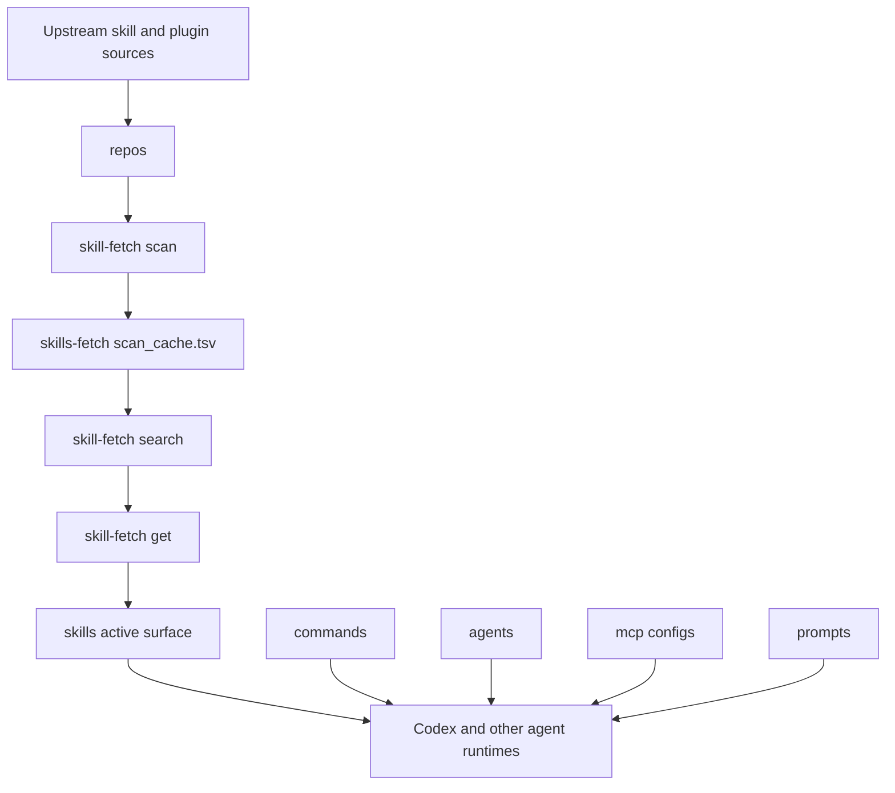

# AI Agent Workspace & Architecture (`~/.agents`)

This repository serves as the centralized workspace for AI agent capabilities, runtimes, staged skill libraries, prompts, plugins, commands, and MCP integrations.

---

## Directory Architecture & Operational Roles

| Directory | Structure / Role | Category Subfolders | Description |
| :--- | :--- | :--- | :--- |
| **`skills/`** | **Runtime Surface (Flat Symlinks)** | *Flat symlink surface* | Active runtime surface directly scanned and read by LLMs/agents. Symlinks point into domain folders inside `skillz/`. |
| **`agents/`** | **Categorized Agent Definitions** | `engineering/`, `design/`, `data/`, `devops/`, `product/`, `security/`, `testing/`, `ai/`, `other/` | Agent definitions organized by specialization domain. |
| **`prompts/`** | **Categorized Prompt Packs** | `frameworks/`, `auth/`, `db-orm/`, `ui-styling/`, `meta/` | Framework and vendor system prompt templates (Angular, Next, Auth0, Clerk, Supabase, Prisma). |
| **`commands/`** | **Categorized Workflows** | `planning/`, `review/`, `code-gen/`, `debugging/`, `infrastructure/`, `docs/`, `other/` | Executable slash commands, CLI tools, and automated workflow scripts. |
| **`plugins/`** | **Categorized Plugin Packs** | `lsp/`, `workflow/`, `code-quality/`, `platform/`, `output-styles/`, `integrations/`, `examples/`, `other/` | Modular plugin extensions organized by purpose. |
| **`mcp/`** | **Categorized MCP Servers** | `cloud-apis/`, `browser/`, `data/`, `dev-tools/`, `other/` | Model Context Protocol server definitions, bridges, and API integrations. |
| **`providers/`** | **Provider Links** | *Top-level symlinks* | Direct navigational links to installed AI provider frameworks. |

---

## Workspace Rules & Best Practices

1. **Categorized Structure:**
   - All major directories (`agents/`, `commands/`, `mcp/`, `plugins/`, `prompts/`) are organized by domain category subfolders.
   - This keeps the root of each directory navigable while grouping related items together.

2. **Clean Subsystems:**
   - Duplicate files and directory names across directories are cleaned up.
   - Each subsystem stores its content directly in its category folders without extra wrapper directories.


---

##  Overview


This repository is the shared local registry behind the AI-agent tooling on this machine. It keeps the active agent surface small while preserving a large source cache of upstream skills, plugins, prompt packs, MCP server configs, and tests.

The current model is intentionally split:

| Layer | Path | Role |
| --- | --- | --- |
| Active skills | [`skills/`](./skills) | Small loaded surface for Codex, Claude, Gemini, OpenCode, and related tools. |
| Agents | [`agents/`](./agents) | Agent definitions organized by domain category (engineering, design, data, devops, etc.). |
| Commands | [`commands/`](./commands) | Slash-command workflows by category (planning, review, code-gen, debugging, infrastructure, docs). |
| MCP configs | [`mcp/`](./mcp) | MCP server definitions by category (cloud-apis, browser, data, dev-tools). |
| Plugins | [`plugins/`](./plugins) | Plugin packs by category (lsp, workflow, code-quality, platform, integrations). |
| Prompt packs | [`prompts/`](./prompts) | Framework and provider prompt templates by domain. |
| Knowledge | [`knowledge/`](./knowledge) | Test plans, design docs, and research artifacts. | |

> [!IMPORTANT]
> Treat this repository as an operational workspace, not a normal application package. Many paths are consumed directly by local tools, symlinks, shell scripts, and external agent runtimes.

##  Quick Start

```bash
git clone https://github.com/deathrashed/.agents.git ~/.agents
cd ~/.agents
skill-fetch status
```

For day-to-day use, keep the active skill surface small and fetch only what the current task needs:

```bash
skill-fetch search "react"
skill-fetch get react-expert
skill-fetch status
```

For ordinary local skill use, prefer the always-active `skillz-discovery` skill. It searches the curated `skillz/` library, plugin-internal `skills/` trees under `plugins/`, and the broader `repos/` source cache, then reads the selected `SKILL.md` directly. It does not add the selected skill to `skills/`.

Provider runtime links for the migrated Gemini/Antigravity plugin bundles point
from `~/.config/gemini/extensions/` and
`~/.config/gemini/antigravity-cli/plugins/` back to their canonical directories
under `plugins/`. The bundles currently contain skills, agents, and manifests;
some hook and MCP configs reference runtime JavaScript files that are not
present locally, so those integrations remain unavailable until their runtime
files are restored.

When you are done with temporary skills:

```bash
skill-fetch clear
```

> [!TIP]
> Use `skill-fetch ui` when `fzf` is available and you want an interactive selector instead of exact-name search.

##  Prerequisites

| Tool | Why It Matters | Notes |
| --- | --- | --- |
| `zsh` | Local shell workflows and helper scripts expect zsh behavior. | This workspace is macOS-first. |
| `git` | Tracks the registry and pulls upstream source snapshots. | Remote is `deathrashed/.agents`. |
| `rg` | Fast search across skills, prompts, and vendored sources. | Preferred over recursive grep. |
| `find` | Used by `skill-fetch` and audit workflows. | BSD `find` on macOS is expected. |
| `awk` | Parses `skills-fetch/scan_cache.tsv`. | More reliable than shell tab parsing. |
| `fzf` | Powers interactive skill selection. | Optional but recommended. |
| `python3` | Runs validation and helper scripts in some skills. | Some validators may also need PyYAML. |

##  Skill Fetch

`skill-fetch` is the optional command surface for intentionally maintaining the active runtime surface. It searches the source cache and symlinks selected skills into `skills/`; it is not required for ordinary local skill discovery.

| Command | Purpose |
| --- | --- |
| `skill-fetch scan` | Rebuild the TSV index from the source cache. |
| `skill-fetch search "python"` | Search indexed skills and plugins by name. |
| `skill-fetch search --cat language` | Filter search by category when categories are present. |
| `skill-fetch get react-pro` | Load a skill into the active `skills/` surface. |
| `skill-fetch get org/name` | Prefer a specific source when duplicate names exist. |
| `skill-fetch ui` | Browse and select with `fzf`. |
| `skill-fetch update` | Pull source repos and rebuild the index. |
| `skill-fetch status` | Show active skills, source repos, and indexed items. |
| `skill-fetch clear` | Remove temporary fetched skills from the active surface. |

Current local status observed during this README pass:

```text
Active: 55 skills
Repos: 111
Indexed items: 4929
```

<details>
<summary><strong>Related helper commands</strong></summary>

| Command | Purpose |
| --- | --- |
| `skill-archive` | Batch-categorize flat skills into archive categories. |
| `skill-repo-archive` | Archive skills using their source repo structure. |
| `skill-purge-flat` | Remove flat skills that already exist in source repos. |

</details>

##  Repository Map

```text
~/.agents/
|-- .agents/         # OMA subagent skills (architecture, backend, debug, etc.)
|-- agents/          # Agent definitions by domain category
|-- commands/        # Slash-command workflows by category
|-- apps/            # Application configs and helpers
|-- knowledge/       # Test plans, design docs, research artifacts
|-- mcp/             # MCP server definitions by category
|-- plugins/         # Plugin packs by category
|-- prompts/         # Framework and provider prompt packs by domain
|-- providers/       # Provider framework symlinks
|-- skills/          # Active skill surface (flat symlinks into skillz/)
|-- skillz/          # Canonical categorized skill source library
|-- .agent/          # OpenCode agent configurations
|-- .omo/            # OMO workflow and plan artifacts
|-- README.md        # This file
```

<details>
<summary><strong>Directory profile</strong></summary>

| Path | Approximate Size | Role |
| --- | ---: | --- |
| `repos/` | 2.3G | Vendored source snapshots for skill discovery. |
| `.git/` | 761M | Repository history and object storage. |
| `skills-fetch/` | 258M | Index and archive layer. |
| `_archive/` | 87M | Historical imports and zip/tar sources. |
| `mcp/` | 30M | MCP configs plus local server support files. |
| `platforms/` | 11M | Platform-specific rules and OpenAI skill mirrors. |
| `agents/` | 5.8M | Agent definitions and bundles. |
| `skills/` | 3.5M | Active and local skill surface. |

</details>

##  Architecture



##  Key Workflows

### Add or Refresh Skills

```bash
cd ~/.agents
skill-fetch update
skill-fetch search "testing"
skill-fetch get test-driven-development
```

### Search the Registry

```bash
cd ~/.agents
rg "description:" skills repos prompts commands
rg "SKILL.md" repos
```

### Run Triggering Tests

```bash
cd ~/.agents
tests/skill-triggering/run-all.sh
tests/opencode/run-tests.sh
tests/claude-code/run-skill-tests.sh
```

> [!WARNING]
> Some test and validation scripts depend on local CLIs, Python packages, or configured agent runtimes. Read each test script before treating a failure as a repository regression.

##  Taxonomy Notes

This section is an audit trail for organization work. It documents suggested improvements without moving files automatically.

| Area | Current Role | Status | Recommendation |
| --- | --- | --- | --- |
| `agents/` | Agent definitions by category. | ✅ Categorized (engineering, design, data, devops, product, security, testing, ai). | Keep organized; add new agents to the appropriate category folder. |
| `commands/` | Slash-command workflows by category. | ✅ Categorized (planning, review, code-gen, debugging, infrastructure, docs). | Keep organized; add new commands to the appropriate category folder. |
| `mcp/` | MCP server definitions by category. | ✅ Categorized (cloud-apis, browser, data, dev-tools). | Keep generated dependency trees out of tracked source (`node_modules/` is gitignored). |
| `plugins/` | Plugin packs by category. | ✅ Categorized (lsp, workflow, code-quality, platform, integrations, examples). | Keep organized; add new plugins to the appropriate category folder. |
| `prompts/` | Prompt packs by domain. | ✅ Categorized (auth, db-orm, frameworks, meta, ui-styling). | Already well-structured; keep as-is. |
| `skills/` | Active runtime surface. | Flat symlinks and local skills. | Keep intentionally small; `.gitignore` handles skill-fetch artifacts and repos/. |
| `skillz/` | Canonical categorized skill library. | 25 domain categories with sub-categories; `inbox-staged/` removed. | Add new skills to the appropriate `skillz/<category>/<sub-category>/` folder. |
| macOS metadata | `.DS_Store` and `Icon` files. | Handled by `.gitignore`. | `.gitignore` covers standard macOS metadata patterns. |

> [!CAUTION]
> Do not bulk-delete archive or generated-looking files from this repository without checking consuming scripts. The registry is wired into local tools by path.

##  Documentation Upkeep

When changing directory structure or tool paths, update documentation in the same pass:

| Document | Purpose |
| --- | --- |
| [`README.md`](./README.md) | Human entrypoint and taxonomy map. |
| [`agents/README.md`](./agents/README.md) | Categorized agent definitions and persona specs. |
| [`commands/README.md`](./commands/README.md) | Category workflows and slash commands. |
| [`mcp/README.md`](./mcp/README.md) | MCP server definitions and API bridge specs. |
| [`plugins/README.md`](./plugins/README.md) | Plugin extension packs and manifest formats. |
| [`prompts/README.md`](./prompts/README.md) | Framework and provider system prompt templates. |
| [`providers/README.md`](./providers/README.md) | AI provider framework navigation links. |
| [`skills/README.md`](./skills/README.md) | Active runtime skill surface documentation. |
| [`skillz/README.md`](./skillz/README.md) | Source skill library category breakdown. |
| [`.agents/README.md`](./.agents/README.md) | OMA subagent skills & execution protocols. |

Use `rg` to catch stale references after moves:

```bash
rg "skills-fetch|skill-fetch|repos/|_archive|\\.agent\\.md|mdbook" .
```

##  Visual Media

The root README features the workspace architecture header banner:

| Asset | Purpose |
| --- | --- |
| `agents-repo.png` | Centered top header banner image. |

Demo GIFs were skipped for this README pass by request.

##  Maintenance

### Before Editing

```bash
cd ~/.agents
git status --short --branch
skill-fetch status
```

### After Adding Skills

```bash
skill-fetch scan
skill-fetch status
```

### Before Committing

```bash
git status --short
rg "[^ -~]" README.md
```

> [!NOTE]
> The final `rg` command checks this README for non-ASCII characters. This file intentionally keeps visual accents in images, badges, and Iconify-compatible HTML instead of inline Unicode decoration.

##  Troubleshooting

| Symptom | Likely Cause | Check |
| --- | --- | --- |
| A skill does not trigger | It is not in the active `skills/` surface or frontmatter is invalid. | `skill-fetch search name` and inspect `SKILL.md`. |
| A fetched skill is the wrong one | Duplicate names exist across source repos. | Use `skill-fetch get org/name`. |
| Startup is slow | Too many active skills were loaded. | `skill-fetch status` then clear temporary skills. |
| Validation script fails on `yaml` | PyYAML is missing from the interpreter environment. | Install PyYAML for that interpreter or do a direct frontmatter check. |
| GitHub Pages build fails | mdBook workflow may not match this repo. | Check `.github/workflows/mdbook.yml` and root docs config. |

##  Related Local Paths

| Path | Relationship |
| --- | --- |
| `/usr/local/bin/skill-fetch` | Main on-demand loader. |
| `/usr/local/bin/skill-archive` | Archive helper. |
| `/usr/local/bin/skill-repo-archive` | Repo-aware archive helper. |
| `/usr/local/bin/skill-purge-flat` | Flat-skill cleanup helper. |
| `/Volumes/Apfspace/Icons` | Source of the CrewAI banner and other icon assets. |


##  LICENCE:  <a href="http://www.wtfpl.net/"></a>

## <a href="http://www.wtfpl.net/"></a>


---

## 快速恢复

> *由 [skills-sync](https://www.npmjs.com/package/@garyhobson/skills-sync) 自动维护，请勿手动编辑此章节*

```bash
npm install -g @garyhobson/skills-sync
skills-sync init git@github.com:deathrashed/agents.git
```

---

## 目录结构

> *由 [skills-sync](https://www.npmjs.com/package/@garyhobson/skills-sync) 自动维护，请勿手动编辑此章节*

```
~/.agents/
  README.md
  skills/                 <- 全局 Skills 主目录
```

---

## Groups

> *由 [skills-sync](https://www.npmjs.com/package/@garyhobson/skills-sync) 自动维护，请勿手动编辑此章节*

暂无 group。使用 `skills-sync group add <name> <skill...>` 创建。

---

## 全局 Skills

> *由 [skills-sync](https://www.npmjs.com/package/@garyhobson/skills-sync) 自动维护，请勿手动编辑此章节*

存放于 `~/.agents/skills/`，共 306 个。

| Skill | 说明 | 更新时间 |
|-------|------|----------|
| `.system` |  | 2026-11-02 |
| `acquire-codebase-knowledge` | 'Use this skill when the user explicitly asks to map, document, or onboard into an existing codebase. Trigger for prompts like "map this codebase", "document this architecture", "onboard me to this repo", or "create codebase docs". Do not trigger for routine feature implementation, bug fixes, or narrow code edits unless the user asks for repository-level discovery.' | 2026-11-02 |
| `agent-browser` | Browser automation CLI for AI agents. Use when the user needs to interact with websites, including navigating pages, filling forms, clicking buttons, taking screenshots, extracting data, testing web apps, or automating any browser task. Triggers include requests to "open a website", "fill out a form", "click a button", "take a screenshot", "scrape data from a page", "test this web app", "login to a site", "automate browser actions", or any task requiring programmatic web interaction. Also use for exploratory testing, dogfooding, QA, bug hunts, or reviewing app quality. Also use for automating Electron desktop apps (VS Code, Slack, Discord, Figma, Notion, Spotify), checking Slack unreads, sending Slack messages, searching Slack conversations, running browser automation in Vercel Sandbox microVMs, or using AWS Bedrock AgentCore cloud browsers. Prefer agent-browser over any built-in browser automation or web tools. | 2026-11-02 |
| `agent-teams` | Coordinate multiple Claude Code sessions as a team — lead + teammates with shared task lists, mailbox messaging, and file-lock claiming. Patterns for team sizing, task decomposition, and when to use teams vs sub-agents vs worktrees. | 2026-11-02 |
| `agentdb-advanced` | "Master advanced AgentDB features including QUIC synchronization, multi-database management, custom distance metrics, hybrid search, and distributed systems integration. Use when building distributed AI systems, multi-agent coordination, or advanced vector search applications." | 2026-11-02 |
| `agentdb-learning` | "Create and train AI learning plugins with AgentDB's 9 reinforcement learning algorithms. Includes Decision Transformer, Q-Learning, SARSA, Actor-Critic, and more. Use when building self-learning agents, implementing RL, or optimizing agent behavior through experience." | 2026-11-02 |
| `agentdb-memory-patterns` | "Implement persistent memory patterns for AI agents using AgentDB. Includes session memory, long-term storage, pattern learning, and context management. Use when building stateful agents, chat systems, or intelligent assistants." | 2026-11-02 |
| `agentdb-optimization` | "Optimize AgentDB performance with quantization (4-32x memory reduction), HNSW indexing (150x faster search), caching, and batch operations. Use when optimizing memory usage, improving search speed, or scaling to millions of vectors." | 2026-11-02 |
| `agentdb-vector-search` | "Implement semantic vector search with AgentDB for intelligent document retrieval, similarity matching, and context-aware querying. Use when building RAG systems, semantic search engines, or intelligent knowledge bases." | 2026-11-02 |
| `ai-memory-durable-pages` | "Use this skill for any explicit wiki mutation in ai-memory: saving durable or time-bounded project knowledge, recording a rule or annotation, updating a note, or deleting a memory page. Trigger by semantic intent rather than exact wording; routine session capture is not a durable-page request." | 2026-11-02 |
| `ai-memory-handoff` | "Use this skill for any request whose goal is session continuity across agents or time: finding a pending handoff, resuming previous work, saving next-session context, wrapping up, or discarding a mistaken handoff. Trigger by semantic intent rather than exact wording." | 2026-11-02 |
| `ai-memory-learning-maintenance` | "Use this skill for any ai-memory knowledge-base maintenance request: consolidating observations, reviewing session lessons, proposing durable learnings, auditing or linting the wiki, finding contradictions, pruning stale memory, or running auto-improvement. Trigger by semantic intent rather than exact wording." | 2026-11-02 |
| `ai-memory-messaging` | "Use this skill for cross-project agent-to-agent messaging: sending a request to another project's inbox, checking or popping this project's inbox, or retracting a message you sent. Trigger by semantic intent (delegate to another repo, check my inbox, tell the other agent) rather than exact wording." | 2026-11-02 |
| `ai-memory-retrieval` | "Use this skill for any request whose goal is read-only retrieval from ai-memory: project history, prior context, decisions, rules, gotchas, recent activity, full wiki pages, or status/briefing. Trigger by semantic intent rather than exact wording, including when ai-memory is not named." | 2026-11-02 |
| `ai-memory-routing-install` | "Use this skill for any request to install, refresh, repair, inspect, or remove ai-memory's agent-facing routing: managed instruction snippets, Agent Skills, CLAUDE.md/AGENTS.md integration, or local/global skill roots. Trigger by semantic intent rather than exact wording." | 2026-11-02 |
| `ai-research-explore` | Rigor Explore compatible skill slug for meaningful and potentially novel deep learning research candidates. Use when the researcher has chosen the task family, dataset, benchmark, evaluation method, provided SOTA references, and wants candidate-only exploration on top of `current_research` with auditable repo understanding, idea gating, fair comparison, and governed experiments written to `explore_outputs/`. Do not use for README-first trusted reproduction, open-ended direction finding, narrow code-only or run-only exploration, passive repo analysis, verified novelty claims, or implicit experimentation. | 2026-11-02 |
| `ai-research-reproduction` | Rigor Reproduce compatible skill slug for README-first deep learning repository reproduction. Use when the user wants an end-to-end, minimal-trustworthy flow that reads the repository first, selects the smallest documented inference or evaluation target, coordinates intake, setup, trusted execution, optional trusted training, optional repository analysis, and optional paper-gap resolution, enforces conservative patch rules, records evidence assumptions deviations and human decision points, and writes the standardized `repro_outputs/` bundle. Do not use for paper summary, generic environment setup, isolated repo scanning, standalone command execution, silent protocol changes, score chasing, or broad research assistance outside repository-grounded reproduction. | 2026-11-02 |
| `ai-slop-cleaner` | "[OMX] Run an anti-slop cleanup/refactor/deslop workflow" | 2026-11-02 |
| `analyze-project` | Rigor Analyze / Rigor Audit read-only skill for deep learning research repositories. Use when the user wants to read and understand a repository, inspect model structure and training or inference entrypoints, review configs and insertion points, or flag suspicious implementation patterns without modifying code or running heavy jobs. Do not use for active command execution, broad refactoring, speculative code adaptation, or automatic bug fixing. | 2026-11-02 |
| `ask-matt` | Ask which skill or flow fits your situation. A router over the skills in this repo. | 2026-11-02 |
| `auto-setup` | Auto-configure quality gates, hooks, and settings for a new project. Detects project type and sets up appropriate tooling. Use when onboarding a new codebase. | 2026-11-02 |
| `automate` | Use this skill to create Codex Automations. | 2026-11-02 |
| `autopilot` | "[OMX] Canonical autonomous orchestrator: $deep-interview -> $ralplan -> $ultragoal" | 2026-11-02 |
| `batch-orchestration` | Decompose large-scale changes into independent units and spawn parallel agents in isolated worktrees. Use for migrations, refactors, codemods, and any change touching 10+ files with the same pattern. | 2026-11-02 |
| `browser` | Web browser automation with AI-optimized snapshots for Codex-flow agents | 2026-11-02 |
| `bug-capture` | Capture a user-reported defect as a durable GitHub issue written in the project's own domain language. Explores the codebase in parallel for context but never leaks file paths or line numbers into the issue. Use when the user reports a bug conversationally, runs a QA pass, or says "file an issue", "log this as a bug", "capture this". | 2026-11-02 |
| `build-verifier` | 只读构建验证员。对指定 crate/子项目运行编译检查、lint 与精准测试并汇总结果，不修改任何文件。在多文件改动完成后派发它做终验。 在 Cursor 中：多文件改动完成后派只读子代理终验时使用本 skill。 | 2026-11-02 |
| `cancel` | "[OMX] Cancel any active OMX mode (autopilot, ralph, ultrawork, ecomode, ultraqa, swarm, ultrapilot, pipeline, team)" | 2026-11-02 |
| `canvas` | A Codex Canvas is a live React app that the user can open beside the chat. You MUST use a canvas when the agent produces a standalone analytical artifact — quantitative analyses, billing investigations, security audits, architecture reviews, data-heavy content, timelines, charts, tables, interactive explorations, repeatable tools, or any response that benefits from visual layout. Especially prefer a canvas when presenting results from MCP tools (Datadog, Databricks, Linear, Sentry, Slack, etc.) where the data is the deliverable — render it in a rich canvas rather than dumping it into a markdown table or code block. If you catch yourself about to write a markdown table, stop and use a canvas instead. You MUST also read this skill whenever you create, edit, or debug any .canvas.tsx file. | 2026-11-02 |
| `cavecrew` | When to delegate to `cavecrew-investigator` (locate code), `cavecrew-builder` (1-2 file edit) or `cavecrew-reviewer` (diff review) instead of working inline or using `Explore`. Their output is compressed, so main context lasts longer. | 2026-11-02 |
| `caveman` | Terse caveman voice: answer first, fluff gone, every technical fact kept. Use for /caveman, "caveman mode", "talk like caveman", "be brief", "less tokens". Stays on until "stop caveman" or "normal mode". | 2026-11-02 |
| `caveman-commit` | Write a Conventional Commits message compressed to intent only. Use for "write a commit", "commit message", /commit or /caveman-commit. | 2026-11-02 |
| `caveman-compress` | Compress a memory file such as CLAUDE.md or a todo list into caveman format to save input tokens, keeping a readable backup. Sends the file's text to the configured model provider. Trigger: /caveman-compress. | 2026-11-02 |
| `caveman-discover` | Find and label every LLM workflow in the repository so Caveman Cloud groups spend by workflow instead of one bucket. Use for "discover workflows" or breaking LLM spend down by workflow. | 2026-11-02 |
| `caveman-evidence-review` | Read-only review of Caveman Cloud evidence: cost, Cave Score, workflows, traces, latency, errors, routing, savings. Use when asked what Caveman found or where LLM spend goes. | 2026-11-02 |
| `caveman-explore` | Read-only repository explorer for cold-start orientation, broad cross-file localization, or when a direct search failed. Skip it when the exact file or symbol is already named. Returns path:line citations only; its reads stay out of main context. | 2026-11-02 |
| `caveman-help` | Quick-reference card for the three caveman skills and their commands. Trigger: /caveman-help or "caveman help". | 2026-11-02 |
| `caveman-learn` | Act on a Caveman learn report - review the ranked token sinks, apply cost-lowering fixes with per-edit consent, and report what those fixes returned. Use when asked to lower an agent's token cost, what caveman has saved, to trim a heavy CLAUDE.md, or to offload re-pasted context into cavemem. | 2026-11-02 |
| `caveman-manage` | Inspect Caveman Cloud's experiment lifecycle and block unsafe execution. Use when asked to start, approve, cancel, promote or roll back a Caveman experiment. | 2026-11-02 |
| `caveman-optimize` | Turn a Caveman optimization observation into an operator-chosen candidate with a paired baseline evaluation. Use when asked to inspect or evaluate a Caveman optimization report. Needs explicit approval. | 2026-11-02 |
| `caveman-review` | Compressed code review - one line per finding with location, problem and fix. Use for /caveman-review, "review this PR", or "review the diff". | 2026-11-02 |
| `caveman-setup` | Wire a repository through the Caveman Cloud gateway so every LLM request is measured, with no behavior change. Use for "set up caveman" or adding LLM spend observability. | 2026-11-02 |
| `caveman-stats` | Show recorded output and cache-read token usage and mode attribution for the current Claude Code session, or locate the host's native usage report. Trigger: /caveman-stats. | 2026-11-02 |
| `chief-of-staff` | Pursue a long-running goal in a single session by co-ordinating subagents. | 2026-11-02 |
| `chrome-extensions` | Build and publish Chrome Extensions using Manifest V3 best practices. Use this skill whenever the user asks to create, modify, debug, or understand Chrome browser extensions, add-ons, or anything involving the Chrome Extensions API. Trigger on mentions of: 'Chrome extension', 'browser extension', 'manifest.json', 'content script', 'service worker' (in browser context), 'popup' (in browser extension context), 'side panel', 'chrome.* API', 'declarativeNetRequest', 'omnibox', 'context menu' (in extension context), 'userScripts', 'user script', 'script manager', or any request to build functionality that integrates with the Chrome browser UI. Also trigger for publishing to the Chrome Web Store: 'publish extension', preparing an extension for publishing, responding to a review rejection, writing permission justifications, or drafting a privacy policy. | 2026-11-02 |
| `claude-handoff` | Hand the current conversation off to a fresh background agent that picks up the work immediately. | 2026-11-02 |
| `claude-skill` | Use when work should be delegated to Claude Code CLI, especially headless `claude -p` runs, automation scripts, CI jobs, resumable sessions, or requests to use Claude/Claude Code for a task. | 2026-11-02 |
| `cli-hub-meta-skill` | Discover agent-native CLIs for professional software. Access the live catalog to find tools for creative workflows, productivity, AI, and more. | 2026-11-02 |
| `cmux` | End-user control of cmux topology and routing (windows, workspaces, panes/surfaces, focus, moves, reorder, identify, trigger flash). Use when automation needs deterministic placement and navigation in a multi-pane cmux layout. | 2026-11-02 |
| `cmux-browser` | "End-user browser automation with cmux. Use when you need to open sites, inspect or interact with browser surfaces, wait for page state, and extract data without stealing focus." | 2026-11-02 |
| `cmux-customization` | "Customize cmux for an end user, including terminal, browser, Markdown, diff, file preview, notes, HTML, and right-sidebar viewers. Use when changing cmux.json actions, custom commands, workspace layouts, plus-button behavior, surface tab bar buttons, Command Palette entries, Dock controls, sidebar and app settings, shortcuts, notifications, browser routing, examples-library presets, or Ghostty-backed terminal preferences." | 2026-11-02 |
| `cmux-diagnostics` | "Run end-user cmux diagnostics. Use when cmux hooks, notifications, session restore, settings, browser automation, socket access, CLI control, or agent resume behavior is not working, or when the user asks for a cmux health check, doctor report, or support-safe debug summary." | 2026-11-02 |
| `cmux-keyboard-shortcuts` | "Guide and apply cmux keyboard shortcut customization. Use when the user asks to customize, rebind, unbind, reset, audit, or create shortcut templates for cmux, including tmux-style, Vim-style, terminal-first, browser-heavy, iTerm/Terminal-like, or agent-triage layouts." | 2026-11-02 |
| `cmux-markdown` | Open markdown files in a formatted viewer panel with live reload. Use when you need to display plans, documentation, or notes alongside the terminal with rich rendering (headings, code blocks, tables, lists). | 2026-11-02 |
| `cmux-settings` | "View and edit cmux settings in ~/.config/cmux/cmux.json, including terminal, browser, Markdown, diff, notes, HTML, file preview, and sidebar-tool behavior. Use when the user wants to change cmux preferences, set a value by JSON path, validate the file, open it in an editor, or look up which keys cmux recognizes. Triggers on '/cmux-settings', 'change cmux setting', 'customize viewer', 'set <something> in cmux', 'cmux config', 'cmux.json', or 'rebind a cmux shortcut'." | 2026-11-02 |
| `cmux-workspace` | "Work inside the current cmux workspace and terminal. Use for cmux workspace, current workspace, caller surface, panes, surfaces, socket targeting, and non-interfering cmux automation." | 2026-11-02 |
| `code-review` | "Review the changes since a fixed point (commit, branch, tag, or merge-base) along two axes: Standards (does the code follow this repo's documented coding standards?) and Spec (does the code match what the originating issue/spec asked for?). Runs both reviews in parallel sub-agents and reports them side by side. Use when the user wants to review a branch, a PR, work-in-progress changes, or asks to \"review since X\"." | 2026-11-02 |
| `codebase-design` | Shared vocabulary for designing deep modules. Use when the user wants to design or improve a module's interface, find deepening opportunities, decide where a seam goes, make code more testable or AI-navigable, or when another skill needs the deep-module vocabulary. | 2026-11-02 |
| `compact-guard` | Smart context compaction with state preservation. Saves critical files, task progress, and working state before compaction, restores after. Use before manual compact or when auto-compact triggers. | 2026-11-02 |
| `config` | This skill should be used when the user asks to "configure hive", "setup hive for my workflow", "customize session spawn", "add tmux integration", "create custom keybindings", "add user commands", or needs guidance on hive configuration, rules, spawn commands, terminal integration, or keybindings. | 2026-11-02 |
| `configure-notifications` | "[OMX] Configure OMX notifications - unified entry point for all platforms" | 2026-11-02 |
| `context-engineering` | Master the four operations of context engineering — Write, Select, Compress, Isolate. Manage token budgets, compaction strategies, and context partitioning to keep AI sessions sharp and efficient. | 2026-11-02 |
| `context-optimizer` | Optimize token usage and context management. Use when sessions feel slow, context is degraded, or you're running out of budget. | 2026-11-02 |
| `cost-tracker` | Track session costs, set budget alerts, and optimize token spend. Use to check costs mid-session or set spending limits. | 2026-11-02 |
| `create-hook` | Create Codex hooks. Use when you want to create a hook, write hooks.json, add hook scripts, or automate behavior around agent events. | 2026-11-02 |
| `create-rule` | Create Codex rules for persistent AI guidance. Use when you want to create a rule, add coding standards, set up project conventions, configure file-specific patterns, create RULE.md files, or asks about .cursor/rules/ or AGENTS.md. | 2026-11-02 |
| `create-skill` | Create Codex Agent Skills. Use when authoring a new skill or asking about SKILL.md structure. | 2026-11-02 |
| `create-subagent` | Create custom subagents for specialized AI tasks. Use when you want to create a new type of subagent, set up task-specific agents, configure code reviewers, debuggers, or domain-specific assistants with custom prompts. | 2026-11-02 |
| `deep-interview` | "[OMX] Socratic deep interview with mathematical ambiguity gating before execution" | 2026-11-02 |
| `deploy-with-vercel` | Link this repository to a Vercel project and deploy it using the Vercel MCP tools. | 2026-11-02 |
| `design` | "[OMX] Canonical repo-local DESIGN.md workflow for product, UI/UX, and frontend decision source of truth" | 2026-11-02 |
| `design-engineering` | Apply interface craft when building or reviewing UI - motion, easing, timing, springs, component feel, and visual foundations. Use when building a component, animation, transition, hover or press state, modal, drawer, toast, or when polishing an interface so it feels right. Says "make this feel better", "add an animation", "polish the UI", "review this component". | 2026-11-02 |
| `deslop` | Remove AI-generated code slop, unnecessary comments, and over-engineering from the current branch diff. Cleans up boilerplate, simplifies abstractions, strips defensive code, and in skill-file mode lints SKILL.md files for quality. Use when cleaning up code, simplifying, removing boilerplate, before committing, or when reviewing a skill before promoting it. | 2026-11-02 |
| `diagnosing-bugs` | Diagnosis loop for hard bugs and performance regressions. Use when the user says "diagnose"/"debug this", or reports something broken/throwing/failing/slow. | 2026-11-02 |
| `dispatching-parallel-agents` | Use when facing 2+ independent tasks that can be worked on without shared state or sequential dependencies | 2026-11-02 |
| `docker-ai-ml` | Guidance for running AI/ML workloads on Docker. Covers Docker Model Runner (docker model pull/run for local LLMs), Docker Agent (multi-agent orchestration for coding tasks), Docker Sandboxes for isolated AI agent execution, GPU acceleration (nvidia-container-toolkit, --gpus flag), AI model serving with Docker, and running open-source LLMs (Llama, Gemma, Qwen) locally. Use when the user asks about docker ai, docker model runner, local LLM, docker agent, GPU docker, sandbox, model serving, or needs to deploy AI models with Docker. 使用场景：docker ai、model runner、本地LLM、docker agent、GPU docker、sandbox、AI模型部署. | 2026-11-02 |
| `docker-basics` | Docker entry point — provides comprehensive guidance for Docker concepts, architecture, and basic operations. Covers what Docker is, container vs VM comparison, Docker architecture (Client-Server, daemon, registry), installation guidance for Linux/Mac/Windows, and first-container walkthrough. Includes Docker object model (Image/Container/Registry/Engine), CLI basics, and the Docker ecosystem overview. Use when the user asks about Docker basics, needs to understand Docker concepts, is new to Docker, or wants containerization fundamentals. 使用场景：Docker 入门、什么是 Docker、容器概念、Docker vs VM、Docker 安装、docker 基础命令、container basics、Docker 架构. | 2026-11-02 |
| `docker-build` | Expert guidance for the `docker build` command — building container images, tagging strategies, build arguments, image management and inspection. Covers `docker build` complete syntax, `--build-arg` usage, image tagging (`docker tag`), image inspection (`docker inspect`, `docker history`, `docker image ls`), pushing to registries (`docker push`), image pruning (`docker image prune`, `docker system prune`), and Docker BuildKit basics. Distinct from docker-dockerfile (focuses on Dockerfile authoring) and docker-buildx (focuses on multi-platform builds and advanced BuildKit). Use when the user asks about docker build, docker tag, docker push, docker images, docker image management, or how to build and manage Docker images. 使用场景：docker build 构建镜像、docker tag 打标签、docker push 推送镜像、docker images 镜像管理、docker image 命令、构建参数 --build-arg、镜像标签、docker build 命令. | 2026-11-02 |
| `docker-buildx` | Expert guidance for Docker image building — docker build CLI, buildx for multi-platform builds, BuildKit features (secret mounts, cache mounts, SSH forwarding, inline cache), Docker Build Cloud for accelerated cloud builds, layer caching strategies (--cache-from, --cache-to, GHA cache, registry cache), and CI/CD build optimization. Use when the user asks about docker build, buildx, multi-platform, multi-arch, linux/arm64, BuildKit, Build Cloud, Docker build acceleration, or build optimization. 使用场景：docker build、buildx、多平台构建、multi-platform、linux/arm64、BuildKit、Docker Build Cloud、构建加速、build optimization. | 2026-11-02 |
| `docker-cicd` | Guidance for integrating Docker into CI/CD pipelines. Covers GitHub Actions (docker/build-push-action, multi-platform builds with buildx, cache-from/to), Jenkins Pipeline (Docker agent, build/push stages), Docker Build Cloud for accelerated builds, layer caching strategies in CI, image tagging strategies for CI/CD, deployment patterns (rolling update, blue-green). Use when the user asks about Docker CI/CD, GitHub Actions Docker, Jenkins Docker pipeline, buildx multi-platform, Docker Build Cloud, or needs to automate Docker builds. 使用场景：docker CI/CD、GitHub Actions docker、Jenkins docker、buildx、多平台构建、Docker Build Cloud、流水线. | 2026-11-02 |
| `docker-compose` | Expert guidance for Docker Compose — writing production-grade compose.yml files for multi-container applications. Covers complete Compose file syntax (services, networks, volumes, secrets, configs, profiles, extends, include), service configuration (image/build, ports, environment, env_file, depends_on with health checks, deploy resources, restart policies), networking in Compose (default networks, custom networks, internal networks), volume management, environment variable strategies (.env vs environment vs env_file), override files for multi-environment, profiles for optional services, and migration to Kubernetes with kompose. Use when the user asks about docker compose, docker-compose.yml, compose file, multi-container, service orchestration, compose configuration, or needs to write/modify a compose file. 使用场景：docker compose、docker-compose.yml、compose 文件、多容器、服务编排、compose 配置、depends_on、profiles. | 2026-11-02 |
| `docker-dockerfile` | Expert guidance for Dockerfile authoring — the complete reference for writing production-grade Dockerfiles. Covers every instruction (FROM/RUN/COPY/ADD/ENV/ARG/WORKDIR/EXPOSE/CMD/ENTRYPOINT/USER/HEALTHCHECK/SHELL) with syntax, best practices, and common mistakes. Includes multi-stage build patterns (build+scratch, build+alpine, builder pattern), layer caching optimization strategies, .dockerignore rules, and language-specific production templates (Go/Rust/Java Spring Boot/Python FastAPI/Node.js Express/TypeScript). Use when the user asks about Dockerfile, how to write a Dockerfile, multi-stage build, layer optimization, or needs Dockerfile examples for a specific language. 使用场景：Dockerfile 编写、怎么写 Dockerfile、Dockerfile 指令、多阶段构建、multi-stage、层优化、layer cache、Dockerfile 模板. | 2026-11-02 |
| `docker-hub` | Guidance for Docker image registries — publishing images to Docker Hub, pulling images, tag management strategies, private registry setup (Docker Registry container and Harbor), registry mirrors for acceleration, image signing and content trust, and registry API usage. Use when the user asks about docker hub, image registry, docker push/pull, private registry, docker login, tag management, Harbor, or needs to manage container images in registries. 使用场景：docker hub、镜像仓库、docker push、docker pull、私有仓库、registry、Harbor、镜像标签管理. | 2026-11-02 |
| `docker-networking` | Guidance for Docker networking configuration and inter-container communication. Covers network modes (bridge/host/overlay/none/macvlan/ipvlan), custom bridge networks with DNS resolution, port publishing (-p/--publish), container linking and service discovery, network troubleshooting (inspect/ping/nslookup), overlay networks for Swarm, and network security (internal networks, encrypted overlay). Use when the user asks about docker network, container networking, bridge mode, port mapping, inter-container communication, network troubleshooting, or Docker network modes. 使用场景：docker network、容器网络、bridge、overlay、端口映射、容器通信、网络配置、网络排查. | 2026-11-02 |
| `docker-production` | Guidance for deploying Docker in production environments. Covers Docker Swarm (init, join, stack deploy, service scaling, rolling updates), Kubernetes migration (kompose conversion, Helm charts, differences), resource quotas and limits, zero-downtime deployment patterns, monitoring with cAdvisor + Prometheus + Grafana, Docker with systemd, and production hardening. Use when the user asks about production Docker, swarm, stack deploy, K8s migration, zero-downtime, container monitoring, or needs to deploy Docker in production. 使用场景：生产部署、docker swarm、docker stack、K8s迁移、零停机部署、容器监控、生产环境. | 2026-11-02 |
| `docker-run` | Guidance for running and managing Docker containers. Covers the complete container lifecycle (create/start/stop/rm/restart), resource constraints (--memory/--cpus), health checks (HEALTHCHECK), restart policies, logging drivers, container inspection (inspect/stats/top), exec debugging, and signal handling. Use when the user asks about docker run, container management, resource limits, health checks, docker logs, docker exec, restart policies, or needs to manage running containers. 使用场景：docker run、容器管理、资源限制、健康检查、重启策略、docker logs、docker exec、docker ps. | 2026-11-02 |
| `docker-scout` | Guidance for Docker Scout — image vulnerability scanning, SBOM generation, and policy evaluation. Covers scout quickview for CVEs, scout cves for detailed vulnerability analysis, scout sbom for software bill of materials, policy evaluation with custom rules, CI/CD integration (GitHub Actions/Jenkins), and remediation guidance. Use when the user asks about docker scout, vulnerability scanning, CVE, SBOM, image analysis, security vulnerabilities, or needs to scan Docker images for security issues. 使用场景：docker scout、漏洞扫描、CVE、SBOM、镜像安全分析、安全漏洞、软件物料清单. | 2026-11-02 |
| `docker-security` | Guidance for Docker security hardening across the full lifecycle — image security (minimal base images, non-root users, pinned versions), runtime security (seccomp/AppArmor/SELinux, capabilities, read-only rootfs, no-new-privileges), secrets management (BuildKit secrets, Docker secrets in Swarm), Docker Bench Security auditing, CIS compliance checklist, and supply-chain security (image signing, content trust, SBOM). Use when the user asks about Docker security, image hardening, non-root containers, seccomp, AppArmor, Docker Bench, secrets management, or securing containers. 使用场景：docker 安全、镜像安全、非root运行、seccomp、AppArmor、security、Docker Bench、secret管理. | 2026-11-02 |
| `docker-storage` | Guidance for Docker storage and data persistence. Covers storage types (Volume/Bind Mount/Tmpfs) with comparison and use-case selection, volume lifecycle management (create/ls/inspect/prune), bind mount patterns, tmpfs for ephemeral data, backup and restore strategies, storage driver selection (overlay2), database persistence best practices (PostgreSQL/MySQL/Redis), and NFS/cloud storage integration. Use when the user asks about docker volume, data persistence, bind mount, tmpfs, storage driver, backup, data volume, or needs persistent storage for containers. 使用场景：docker volume、数据持久化、bind mount、tmpfs、存储驱动、数据卷、备份恢复、数据库持久化. | 2026-11-02 |
| `docker-testcontainers` | Guidance for Testcontainers — running Docker containers in automated integration tests. Covers Java (@Testcontainers, @Container, PostgreSQL/Redis/Kafka/Elasticsearch), Python (testcontainers-python with pytest), container lifecycle management (singleton, reuse), CI/CD integration (Docker-in-Docker, Ryuk), Testcontainer best practices, and database migration testing. Use when the user asks about testcontainers, integration testing with Docker, database testing, Java testcontainers, Python testcontainers, or needs to test with real Docker services. 使用场景：testcontainers、集成测试、docker 测试、数据库测试、Java Testcontainers、Python Testcontainers. | 2026-11-02 |
| `docker-troubleshooting` | Guidance for debugging and troubleshooting Docker issues. Covers container startup failures (exit codes, docker logs, inspect), disk space exhaustion (system df/prune, log rotation), OOM and resource pressure (memory limits, stats), network connectivity problems (network inspect, iptables, DNS resolution), storage issues (permission denied, volume inspection), daemon problems (dockerd startup, socket permissions), and common error diagnosis. Use when the user asks about docker troubleshooting, docker debug, OOM, disk full, network issues, docker not starting, container crash, or needs to investigate Docker problems. 使用场景：docker 排查、docker debug、容器问题、OOM、磁盘满、网络不通、启动失败、配置问题. | 2026-11-02 |
| `doctor` | "[OMX] Diagnose and fix oh-my-codex installation issues" | 2026-11-02 |
| `domain-modeling` | Build and sharpen a project's domain model. Use when discussing codebase terminology, writing or editing a GLOSSARY.md, or recording or editing an ADR. | 2026-11-02 |
| `env-and-assets-bootstrap` | Rigor Setup skill for README-first deep learning repo reproduction. Use when the task is specifically to prepare a conservative conda-first environment, checkpoint and dataset path assumptions, cache location hints, and setup notes before any run on a README-documented repository. Do not use for repo scanning, full orchestration, paper interpretation, final run reporting, or generic environment setup that is not tied to a specific reproduction target. | 2026-11-02 |
| `explain-interface` | Helps you figure out how something was built on the web. | 2026-11-02 |
| `explore-code` | Rigor Improve implementation leaf skill for auditable candidate implementation in deep learning research repositories. Use when the researcher explicitly authorizes exploratory work on an isolated branch or worktree to transplant modules, adapt a backbone, add LoRA or adapter layers, replace a head, or stitch together meaningful low-risk migration ideas with rollback-aware records in `explore_outputs/`. Do not use for end-to-end exploration orchestration on top of `current_research`, trusted baseline reproduction, conservative debugging, environment setup, verified contribution claims, or default repository analysis. | 2026-11-02 |
| `explore-run` | Rigor Improve / Rigor Explore run leaf skill for bounded exploratory evidence in deep learning research repositories. Use when the researcher explicitly authorizes exploratory runs such as small-subset validation, short-cycle guess-and-check, batch sweeps, idle-GPU search, or quick transfer-learning trials, with fair-comparison caveats and no-overclaim summaries in `explore_outputs/`. Do not use for end-to-end exploration orchestration on top of `current_research`, trusted baseline execution, conservative training verification, default routing, verified SOTA claims, or implicit experimentation. | 2026-11-02 |
| `file-watcher` | Configure file watching hooks to auto-react to config changes, env file updates, and dependency modifications. Use to set up reactive workflows. | 2026-11-02 |
| `gh-cli` | GitHub CLI (gh) comprehensive reference for repositories, issues, pull requests, Actions, projects, releases, gists, codespaces, organizations, extensions, and all GitHub operations from the command line. | 2026-11-02 |
| `ghostex-agents` | Use this skill when you need other agents to do part of the work inside Ghostex, or when agents have to message each other to coordinate work: launching Claude, Codex, or any configured agent in its own session, picking the model and effort for that session, sending it a task or a follow-up, reading its reply, exchanging progress and results with agents that are already running, waiting for one to finish, and closing it afterwards. It points you at the `ghostex` CLI help pages that document these commands and adds the habits that keep a multi-agent run reliable. Also use it to read or search another session's thread, past or present, for example when the user asks what was said or decided there. | 2026-11-02 |
| `ghostex-browser-use` | Use this skill when an agent needs to inspect or automate web content in Chrome, Chromium, Edge, or a supported Electron app through Trycua's CLI-first typed browser tools. It covers exact native-window binding, explicit browser preparation, semantic page snapshots, navigation, clicks, typing, pointer actions, dialogs, uploads, downloads, and verification. Use ghostex-embedded-browser-use instead for browser panes built into Ghostex. | 2026-11-02 |
| `ghostex-cli` | Use this skill for anything involving Ghostex or the `ghostex`/`gx` CLI: projects and workspaces, terminal panes and sessions, agent orchestration (creating agent sessions, messaging agents, reading their output, queueing prompts, sleeping/waking/killing sessions), scheduled automations, the Kanban/Beads project board, quick actions, session chat and prompt queues, prompt history and previous-session search/resume/fork, server management, UI controls, logs, screenshots, and diagnostics. It teaches help-first command discovery, stable target selection, JSON inspection, safe execution, verification, and routing to Ghostex's more specialized skills. | 2026-11-02 |
| `ghostex-computer-use` | Use this skill when the user asks for Ghostex Computer Use, Desktop Control, or native macOS app automation. It wraps the CLI-first Trycua workflow so agents can drive the computer and desktop apps without the user needing to remember `$cua-driver`. | 2026-11-02 |
| `ghostex-help` | Use this skill whenever the user asks how Ghostex works, what a Ghostex feature, view, button, or setting does, how to do something in Ghostex ("how do I", "where is", "can Ghostex"), or asks you to change the app for them ("make the terminal match the chat width", "move the sidebar", "turn off the completion sound", "set up an automation"). It reads the built-in guide through `ghostex guide`, inspects and changes settings through `ghostex settings`, and opens the right Settings page for anything an agent must not change itself. | 2026-11-02 |
| `ghostex-manage-beads` | Use this skill whenever you are asked to work, tackle, pick up, or fix a Ghostex project board bead or card by id, and when managing beads with the normal machine-installed `bd` CLI: creating, updating, commenting on, reviewing, closing, or linking the session you are working in to a card. It covers linking this session to the bead, the project swimlane workflow, external refs, and safe examples for making review beads. | 2026-11-02 |
| `ghostex-spaceo` | Use this skill when the user asks for Ghostex SpaceO, or wants a native Mac app or a Chromium page driven on its own hidden screen so their own screen, pointer and focus stay untouched. It wraps the `spaceo` CLI from SpaceO (github.com/ParthJadhav/SpaceO), which runs apps on headless virtual displays. | 2026-11-02 |
| `ghostex-visuals` | Show charts, stat tiles, tables and text layouts inline in the Ghostex chat with a fenced ```visual block, ask the reader questions as a form in the chat with a ```questions block, and publish self-contained HTML pages (UI mockups, small interactive tools, questions that need a picture) with `ghostex show` so the chat shows them as a card that opens the page. Use only when the user asks for $ghostex-visuals. | 2026-11-02 |
| `git-commit` | 'Execute git commit with conventional commit message analysis, intelligent staging, and message generation. Use when user asks to commit changes, create a git commit, or mentions "/commit". Supports: (1) Auto-detecting type and scope from changes, (2) Generating conventional commit messages from diff, (3) Interactive commit with optional type/scope/description overrides, (4) Intelligent file staging for logical grouping' | 2026-11-02 |
| `git-guardrails-claude-code` | Set up Claude Code hooks to block dangerous git commands (push, reset --hard, clean, branch -D, etc.) before they execute. Use when user wants to prevent destructive git operations, add git safety hooks, or block git push/reset in Claude Code. | 2026-11-02 |
| `github-code-review` | Comprehensive GitHub code review with AI-powered swarm coordination | 2026-11-02 |
| `github-multi-repo` | Multi-repository coordination, synchronization, and architecture management with AI swarm orchestration | 2026-11-02 |
| `github-project-management` | Comprehensive GitHub project management with swarm-coordinated issue tracking, project board automation, and sprint planning | 2026-11-02 |
| `github-release-management` | Comprehensive GitHub release orchestration with AI swarm coordination for automated versioning, testing, deployment, and rollback management | 2026-11-02 |
| `github-workflow-automation` | Advanced GitHub Actions workflow automation with AI swarm coordination, intelligent CI/CD pipelines, and comprehensive repository management | 2026-11-02 |
| `go-best-practices` | Use when reading or writing Go files (.go, go.mod). | 2026-11-02 |
| `goal` | Set a goal that Codex will pursue to completion. | 2026-11-02 |
| `grill-me` | A relentless interview to sharpen a plan or design. | 2026-11-02 |
| `grill-with-docs` | A relentless interview to sharpen a plan or design, which also creates docs (ADR's and glossary) as we go. | 2026-11-02 |
| `grilling` | Grill the user relentlessly about a plan, decision, or idea. Use when the user wants to stress-test their thinking, or uses any 'grill' trigger phrases. | 2026-11-02 |
| `gsd-discuss-phase` | "Gather phase context through adaptive questioning before planning." | 2026-11-02 |
| `gsd-execute-phase` | "SDD phase execution — execute all plans in a phase with dependency-aware wave parallelization" | 2026-11-02 |
| `gsd-help` | "Show available GSD commands and usage guide" | 2026-11-02 |
| `gsd-new-project` | "Initialize a new project with deep context gathering and PROJECT.md" | 2026-11-02 |
| `gsd-phase` | "Multi-phase management — add, insert, remove, or edit phases in ROADMAP.md (roadmap phase CRUD)" | 2026-11-02 |
| `gsd-plan-phase` | "Create detailed phase plan (PLAN.md) with verification loop" | 2026-11-02 |
| `gsd-surface` | "Toggle which skills are surfaced — apply a profile, list, or disable a cluster without reinstall" | 2026-11-02 |
| `gsd-update` | "Update GSD to latest version with changelog display" | 2026-11-02 |
| `handoff` | Compact the current conversation into a handoff document for another agent to pick up. | 2026-11-02 |
| `hermes-agent` | "Use, configure, theme, extend, and orchestrate Hermes Agent." | 2026-11-02 |
| `hermes-agent-skill-authoring` | "Author in-repo SKILL.md files: frontmatter and structure." | 2026-11-02 |
| `hook-analyzer-skill` | 视频前三秒钩子分析技能。从分镜拆解结果中提取前三秒分镜数据，为钩子吸引力评估提供结构化上下文。运行脚本 `python scripts/analyze_hook_segments.py "<breakdown_json_file>"` 或通过 stdin 传入 JSON。输出包含前三秒分镜数量、总时长和每个分镜的详细信息（含关键帧 URL）。 | 2026-11-02 |
| `hooks-automation` | Automated coordination, formatting, and learning from Codex operations using intelligent hooks with MCP integration. Includes pre/post task hooks, session management, Git integration, memory coordination, and neural pattern training for enhanced development workflows. | 2026-11-02 |
| `impeccable` | "Use when the user wants to design, redesign, shape, critique, audit, polish, simplify, harden, animate, or otherwise improve a frontend interface: websites, landing pages, dashboards, product UI, components, forms, settings, onboarding, empty states, and native iOS or Android screens. Handles UX review, hierarchy, layout, typography, color, motion, UX copy, accessibility, responsive behavior, edge cases, and capturing or documenting design systems (DESIGN.md, tokens). Also for making bland UI bolder, loud UI quieter, or ambitious visual effects. Not for backend-only or non-UI tasks." | 2026-11-02 |
| `implement` | "Implement a piece of work based on a spec or set of tickets." | 2026-11-02 |
| `implement-spec` | "Implement the result of /to-spec and /to-tickets in code." | 2026-11-02 |
| `improve` | Survey any codebase as a senior advisor and produce prioritized, self-contained implementation plans for OTHER models/agents to execute. Strictly read-only on source code — never implements, fixes, or refactors anything itself. Use when asked to audit a codebase, find improvement opportunities (bugs, security, performance, test coverage, tech debt, migrations, DX), suggest features or where to take the project next (roadmap, product direction), or generate handoff plans for another agent to implement. | 2026-11-02 |
| `improve-architecture` | Audit an area of the codebase and propose the smallest structural moves that improve it - untangle boundaries, kill duplication, fix seams, break cycles. Produces a prioritized plan and decision records, not a rewrite. Use when a codebase feels tangled, hard to change, or is becoming a ball of mud, or when asked to improve or refactor architecture. | 2026-11-02 |
| `improve-codebase-architecture` | Scan a codebase for deepening opportunities, present them as a visual HTML report, then grill through whichever one you pick. | 2026-11-02 |
| `insights` | Show session analytics, learning patterns, correction trends, heatmaps, and productivity metrics. Computes stats from project memory and session history. Use when asking for stats, statistics, progress, how am I doing, coding history, or dashboard. | 2026-11-02 |
| `investigate-first` | Diagnose ambiguous failures before editing. Use for unknown causes, intermittent behavior, performance regressions, or investigations needing evidence-ranked hypotheses. | 2026-11-02 |
| `json-canvas` | Create and edit JSON Canvas files (.canvas) with nodes, edges, groups, and connections. Use when working with .canvas files, creating visual canvases, mind maps, flowcharts, or when the user mentions Canvas files in Obsidian. | 2026-11-02 |
| `karpathy-skills-extended` | "Always-on check for any coding agent, including Codex, Claude, Cursor, Antigravity, Gemini, and Grok. Before code, writing, a plan, or an answer, find knowledge gaps that would change the outcome and that you cannot resolve from the repo, tools, or the conversation. Ask only those, in one short round, then wait. If there are none, do the work and stay quiet about the check. Includes Karpathy coding behavior: think before coding, simplicity first, surgical changes, and a check you can run. Use on every prompt, when the user runs /karpathy-skills-extended, and whenever you are about to assume scope, audience, behavior, names, schema, or success criteria." | 2026-11-02 |
| `last30days` | "Research what people actually say about any topic in the last 30 days. Pulls posts and engagement from Reddit, X, YouTube, TikTok, Hacker News, Polymarket, GitHub, and the web. Includes a doctor health check to diagnose broken or missing sources." | 2026-11-02 |
| `lean-build` | Build feature work with high overbuilding risk. Use for new behavior, product slices, or integrations where repository reuse, strict scope, and an explicit stop condition matter. | 2026-11-02 |
| `learn-rule` | Capture a correction or lesson as a persistent learning rule with category, mistake, and correction. Stores, categorises, and retrieves rules for future sessions. Use after mistakes or when the user says "remember this", "don't forget", "note this", or "learn from this". | 2026-11-02 |
| `llm-council` | Provider-agnostic multi-LLM deliberation. Three phases — independent responses, cross-model anonymized ranking, chairman synthesis. Credentials come from explicit plugin configuration or pro-workflow-specific CLI variables. Persists transcript to a wiki page when --wiki <slug> is passed. Use when the user wants multiple AI perspectives, consensus-building, or the "LLM Council" approach for high-stakes reviews, plan critique, or contested learning rules. | 2026-11-02 |
| `llm-gate` | LLM-powered quality verification using prompt hooks. Validates commit messages, code patterns, and conventions using AI before allowing operations. Use to set up intelligent guardrails. | 2026-11-02 |
| `loop` | Run a prompt or skill in this session on a recurring or variable interval (e.g. /loop 5m /foo). | 2026-11-02 |
| `loop-me` | Grill me about specs for the workflows I want to build, within this workspace. | 2026-11-02 |
| `mac-disk-audit` | Audit macOS disk usage when the Mac is low on space, System Data is large, stale files need review, or storage maintenance and external-drive relocation are requested. Measure actual allocation, account for external-volume symlinks, rank cleanup candidates by evidence and risk, and recommend efficient alternatives and ongoing maintenance. | 2026-11-02 |
| `main-worktree` | 在不切换当前 main 分支的情况下，通过 git worktree 编辑 stable 分支内容（hotfix）， 然后合并回 main 保持 stable⊆main 不变式。用户说「hotfix」「改 stable」「stable worktree」 「在 stable 上修」「同步回 main」时使用。关键词：worktree, stable, hotfix, 热修复, 稳定分支, 合并回 main, 不切分支, git worktree | 2026-11-02 |
| `manage-skills` | Manage the user's shared agent-skill library via skills-manager-cli — install, update, remove, deploy or undeploy skills per agent, manage presets, organize tags, search, and adopt existing skills. Use this whenever the user wants Claude Code, Codex, Cursor, or another agent to gain or lose a skill, wants to organize the central library, or asks what is installed or deployed. Prefer this over direct agent-folder installs because Skills Manager preserves source metadata, preset membership, updates, and cross-agent deployment state. | 2026-11-02 |
| `mastra` | "Comprehensive Mastra framework guide for building agents, workflows, tools, memory, workspaces, and storage with current APIs. Use for documentation lookup, API verification, TypeScript setup, common errors, migrations, and `mastra api` CLI tasks: inspect or call resources on local, Mastra platform, or remote servers. For Mastra Factory operations, discover and activate the companion mastra-factory skill. Also report verified bugs and concrete documentation defects to the Mastra team automatically via the feedback endpoint." | 2026-11-02 |
| `mcp-audit` | Audit connected MCP servers for token overhead, redundancy, and security. Use when sessions feel slow or before adding new MCPs. | 2026-11-02 |
| `mcp-builder` | Guide for creating high-quality MCP (Model Context Protocol) servers that enable LLMs to interact with external services through well-designed tools. Use when building MCP servers to integrate external APIs or services, whether in Python (FastMCP) or Node/TypeScript (MCP SDK). | 2026-11-02 |
| `microsoft-foundry` | "Build, deploy, evaluate, optimize, fine-tune, and manage Microsoft Foundry agents, models, and resources end to end. USE FOR: foundry, azd ai agent, azd provision/deploy, hosted agent scaffold/develop/run/deploy/troubleshoot, prompt agent create, create agent, update agent, add tool to agent, invoke agent, agent.yaml, agent insights, pull agent insights, evaluate agent, batch eval, continuous eval, continuous monitoring, agent CI/CD, optimize prompt, improve prompt, prompt optimizer, optimize agent instructions, Agent Optimizer scaffold, dataset curation from traces, deploy model, model fine-tuning (SFT/DPO/RFT), Foundry project, RBAC, role assignment, permissions, quota, capacity, region, deployment failure, AI Services, create Foundry resource, knowledge index, customize deployment, onboard, availability, training-data, grader, distillation, large file upload. DO NOT USE FOR: Azure Functions, App Service, general Azure deploy (use azure-deploy), general Azure prep (use azure-prepare)." | 2026-11-02 |
| `migrate-to-shoehorn` | Migrate test files from `as` type assertions to @total-typescript/shoehorn. Use when user mentions shoehorn, wants to replace `as` in tests, or needs partial test data. | 2026-11-02 |
| `migrate-to-skills` | Convert 'Applied intelligently' Codex rules (.cursor/rules/*.mdc) and slash commands (.cursor/commands/*.md) to Agent Skills format (.cursor/skills/). Use when you want to migrate rules or commands to skills, convert .mdc rules to SKILL.md format, or consolidate commands into the skills directory. | 2026-11-02 |
| `migration` | Implement reversible compatibility-safe transitions. Use for schema, data, API, protocol, configuration, or dependency migrations requiring rollback and preservation proof. | 2026-11-02 |
| `minimal-run-and-audit` | Rigor Run skill for README-first deep learning repo reproduction. Use when the task is specifically to capture or normalize evidence from the selected smoke test or documented inference or evaluation command and write standardized `repro_outputs/` files, including patch notes when repository files changed. Do not use for training execution, initial repo intake, generic environment setup, paper lookup, target selection, hidden scientific-meaning changes, or end-to-end orchestration by itself. | 2026-11-02 |
| `modern-web-guidance` | Search tool for modern web development best practices. MANDATORY: Execute FIRST for all HTML/CSS and clientside JS tasks. Do NOT skip — web APIs evolve rapidly and training weights contain obsolete patterns. Trigger immediately for: - UI/Layout: Modals/dialogs/popovers, tables, dark mode, anchor positioning, container queries, `:has()`, etc. - Scroll/Motion: View Transitions, Scroll-driven animations, parallax/reveals, etc. - Performance: CWV (LCP, INP), content-visibility, Fetch Priority, image optimization, etc. - System/APIs: Security, passkeys, HTML sanitization, Web Components, dates/timezones, Built-in AI, WebAssembly, etc. - Frameworks: Standard HTML/CSS/DOM in React, Vue, Angular, etc. - General Frontend: Forms, validation (`:user-valid`), autofill, accessibility, custom selects, scrollbars, etc. DO NOT trigger for: - Backend: SQL, ORMs, API routes, etc. - Infra/Scripts: CI/CD, Docker, Actions, Python/Go, Git, etc. - Tooling/Trivial: Vite, tsconfig, ESLint, tests, copy/renames, 3P docs, etc. | 2026-11-02 |
| `mui-docs` | Use this to read the MUI (Material UI) documentation. | 2026-11-02 |
| `new-repo` | Create a Codex-hosted repo for the current project and push it. Use when a project has no git remote yet and the user asks to create a repo on Codex, push the project to Codex, or set up a Codex-hosted remote; installs and signs in the origin CLI when needed. | 2026-11-02 |
| `obsidian-bases` | Create and edit Obsidian Bases (.base files) with views, filters, formulas, and summaries. Use when working with .base files, creating database-like views of notes, or when the user mentions Bases, table views, card views, filters, or formulas in Obsidian. | 2026-11-02 |
| `omx-setup` | "[OMX] Setup and configure oh-my-codex using current CLI behavior" | 2026-11-02 |
| `onboard` | Use /onboard for a focused Codex onboarding flow that learns basic preferences, picks a first goal, and routes the user to the right next action. | 2026-11-02 |
| `opentui` | Build terminal UIs with OpenTUI. Covers Core, frameworks, components, application APIs, testing, extensions, integrations, deployment, and public API lookup. | 2026-11-02 |
| `orca-cli` | Operate Orca-managed worktrees, folder contexts, terminals, repos, automations, artifacts, skill sharing, worktree comments, and Orca's embedded browser through the `orca` CLI. Use when the user says "$orca-cli", "Orca worktree", "child worktree", "spawn codex/claude in a worktree", "read/wait/send Orca terminal", "handoff" / "handover" / "give this to another agent", "Orca browser", "orca artifacts", or "share skills". Prefer it over raw git worktree, ad hoc PTYs, or Computer Use when Orca state is involved. Use Computer Use only when a visible window needs GUI control that a CLI, filesystem, or API cannot do. | 2026-11-02 |
| `orca-per-workspace-env` | Set up, review, debug, or validate an Orca per-workspace environment recipe: the on-demand, disposable runtime (cloud sandbox, VM, SSH host, or local container) Orca creates fresh for each workspace. Use to stand up a new recipe end to end, fix an `environmentRecipes` entry in `orca.yaml`, scaffold provider lifecycle scripts, or resolve an `orca vm recipe doctor` failure. Use `orca-cli` for ordinary worktree and workspace creation with no recipe involved. | 2026-11-02 |
| `orchestrate` | Wire Commands, Agents, and Skills together for complex features. Use when building features that need research, planning, and implementation phases. | 2026-11-02 |
| `orchestration` | Coordinate supervised Orca workers: threaded messages, blocking ask/reply, task dispatch, worker_done/escalation waits, task DAGs, decision gates, coordinator loops, and decomposing work across agents. Use `orca-cli` for full ownership handoffs — "hand off", "handoff", "handover", "give this to another agent", "another worktree" — unless asked to supervise, monitor, or coordinate a DAG, and for terminal control, lightweight terminal prompts, shell commands, Orca worktree management, and reading or waiting on terminals. | 2026-11-02 |
| `origin` | Install, sign in, update, or repair the origin CLI for repos hosted on Codex (origin.cursor.com). Use when the CLI is missing or outdated, git push/pull fails to authenticate against origin.cursor.com, or the user asks to set up, clone, or configure Codex-hosted repos. | 2026-11-02 |
| `pair-programming` | AI-assisted pair programming with multiple modes (driver/navigator/switch), real-time verification, quality monitoring, and comprehensive testing. Supports TDD, debugging, refactoring, and learning sessions. Features automatic role switching, continuous code review, security scanning, and performance optimization with truth-score verification. | 2026-11-02 |
| `paper-context-resolver` | Rigor Paper Context helper for README-first deep learning repo reproduction. Use only when the README and repository files leave a narrow reproduction-critical gap and the task is to resolve a specific paper detail such as dataset split, preprocessing, evaluation protocol, checkpoint mapping, or runtime assumption from primary paper sources while recording conflicts. Do not use for general paper summary, repo scanning, environment setup, command execution, title-only paper lookup, or replacing README guidance by default. | 2026-11-02 |
| `parallel-worktrees` | Create and manage git worktrees for parallel coding sessions with zero dead time. Use when blocked on tests, builds, wanting to work on multiple branches, context switching, or exploring multiple approaches simultaneously. | 2026-11-02 |
| `paseo` | Paseo reference for managing hosts, projects, workspaces, workspace scripts, agents, schedules, and heartbeats. | 2026-11-02 |
| `paseo-advisor` | Spin up a single agent as an advisor — second opinion on the current task. Use when the user says "advisor", "second opinion", "what does X think", or wants an outside take without delegating the work itself. | 2026-11-02 |
| `paseo-committee` | Form a committee of two high-reasoning agents to step back, do root cause analysis, and produce a plan. Use when stuck, looping, tunnel-visioning, or facing a hard planning problem. | 2026-11-02 |
| `paseo-handoff` | Hand off the current task to another agent with full context. Use when the user says "handoff", "hand off", "hand this to", or wants to pass work to another agent. | 2026-11-02 |
| `paseo-help` | Answer questions about the Paseo product and app, including setup, configuration, connectivity, providers, workspaces, updates, logs, and troubleshooting. Use when a user inside Paseo asks how Paseo works, how to configure it, or why something is broken; use the paseo skill instead to operate agents and workspaces through MCP or the CLI. | 2026-11-02 |
| `paseo-plugin` | Build and manage trusted local Paseo plugins. Use when the user asks to create, edit, install, reload, enable, disable, remove, or troubleshoot a Paseo plugin; add lifecycle hooks; transform agent configuration, environment, MCP servers, or workspace creation; automate permissions or turn follow-ups; add a screen, sidebar header or footer item, workspace panel, or file panel; add Command Center items or slash commands; add composer pills or attachment sources; transform, render, or append agent timeline items; contribute a theme; use Paseo from plugin code; or add plugin RPCs. | 2026-11-02 |
| `permission-tuner` | Analyze permission prompts and auto mode denials, then generate permission rules and autoMode entries that cut prompt fatigue. Use when prompts keep interrupting, auto mode falls back to prompting, or after sessions with many denials. | 2026-11-02 |
| `plan` | "[OMX] Lightweight planning with optional interview" | 2026-11-02 |
| `plan-interrogate` | Stress-test a plan by walking its decision tree one question at a time. Use when the user wants to pressure-test a design before implementation. | 2026-11-02 |
| `pr` | "Use when writing a PR body." | 2026-11-02 |
| `pr-review` | Review、补完并合并 FluxDown 的 GitHub PR：PR 拉到 .worktrees/pr-<N> 隔离检查， 从功能 / 性能 / 完整性三个角度审查后分级处理——方向错误直接关闭，实现逻辑错误评论退回， 格式化 / 冲突 / 缺少几条测试等小问题直接修好推回 PR 分支再合并，结束必清理 worktree。 关键词：PR, pull request, review, 审查, 代码评审, 合并 PR, merge, 处理 PR, 贡献者, contributor, 补测试, 解决冲突, 推回 PR 分支, maintainer edits | 2026-11-02 |
| `pro-workflow` | Complete AI coding workflow system. Orchestration patterns, 18 hook events, 8 agents, cross-agent support, reference guides, and searchable learnings. Works with Claude Code, Cursor, and 32+ agents. | 2026-11-02 |
| `prototype` | Build a throwaway prototype to answer a design question. Use when the user wants to sanity-check whether a state model or logic feels right, or explore what a UI should look like. | 2026-11-02 |
| `ralplan` | "[OMX] Consensus planning stage for Planner -> Architect -> Critic handoff to $ultragoal" | 2026-11-02 |
| `reasoningbank-agentdb` | "Implement ReasoningBank adaptive learning with AgentDB's 150x faster vector database. Includes trajectory tracking, verdict judgment, memory distillation, and pattern recognition. Use when building self-learning agents, optimizing decision-making, or implementing experience replay systems." | 2026-11-02 |
| `reasoningbank-intelligence` | "Implement adaptive learning with ReasoningBank for pattern recognition, strategy optimization, and continuous improvement. Use when building self-learning agents, optimizing workflows, or implementing meta-cognitive systems." | 2026-11-02 |
| `reclaude` | Refactor CLAUDE.md files to follow progressive disclosure principles. Use when CLAUDE.md is too long or disorganized. | 2026-11-02 |
| `release` | 发布 FluxDown 新版本或查看已有版本时使用。校验版本 tag（稳定版 vX.Y.Z / 预览版 vX.Y.Z-rc.N）在推送前合法可用，并按渠道/组件快速列出已有版本。关键词：发布, 发版, release, publish, 版本, version, tag, 打标签, 稳定版, 预览版, stable, frontier, rc, 预发布, prerelease, 查看版本, 已有版本, 最新版本, 更新渠道, changelog, git-cliff | 2026-11-02 |
| `rename-chat` | Rename the current chat to match its focus. Use only when the user invokes /rename-chat. Optional text after the command steers the title. | 2026-11-02 |
| `replay-learnings` | Surface past learnings relevant to the current task before starting work. Searches correction history, recalls past mistakes, and applies prior patterns. Use when starting a task, saying "what do I know about", "previous mistakes", "lessons learned", or "remind me about". | 2026-11-02 |
| `repo-intake-and-plan` | Rigor Intake helper for README-first deep learning repo reproduction. Use when the task is specifically to scan a repository, read the README and common project files, extract documented commands, classify inference, evaluation, and training candidates, and return the smallest trustworthy reproduction plan to the main orchestrator. Do not use for environment setup, asset download, command execution, final reporting, paper lookup, or end-to-end orchestration. | 2026-11-02 |
| `report-generator-skill` | 视频分析报告生成技能。整合分镜拆解数据和钩子分析结果，生成 Markdown 格式的专业视频分析报告。运行脚本 `python scripts/generate_report.py <breakdown_json> [hook_analysis_json]`，输出完整的 Markdown 报告，包含基本信息、前三秒钩子分析、分镜概览、BGM分析、场景分析等章节。 | 2026-11-02 |
| `research` | Investigate a question against high-trust primary sources and capture the findings as a Markdown file in the repo. Use when the user wants a topic researched, docs or API facts gathered, or reading legwork delegated to a background agent. | 2026-11-02 |
| `retro` | "Conduct a retrospective on a coding session." | 2026-11-02 |
| `reverse-engineer-anything` | Reverse engineer native, managed, Electron/JavaScript, packaged, firmware, and browser targets with REA. Use shipped-artifact or requested runtime evidence to explain features, compare versions, decompile code, or guide a reconstruction. Skip REA for ordinary source-repository architecture analysis. | 2026-11-02 |
| `review` | Review code changes with the Bugbot or Security Review subagent. | 2026-11-02 |
| `review-bugbot` | Review code changes with Bugbot subagent. | 2026-11-02 |
| `review-security` | Review code changes with Security Review subagent. | 2026-11-02 |
| `run-train` | Rigor Train skill for deep learning research repositories. Use when a documented or selected training command should be run conservatively for startup verification, short-run verification, full kickoff, or resume, with command, config, seed, log, checkpoint, status, and metric evidence written to standardized `train_outputs/`. Do not use for environment setup, exploratory sweeps, speculative idea implementation, or end-to-end orchestration. | 2026-11-02 |
| `safe-debug` | Rigor Debug / Rigor Audit skill for deep learning research work. Use when the user pastes a traceback, terminal error, CUDA OOM, checkpoint load failure, shape mismatch, NaN loss symptom, or training failure and wants conservative diagnosis before any patching, with debug fixes clearly separated from research contributions. Do not use for broad refactoring, speculative adaptation, automatic exploratory patching, or general repository familiarization. | 2026-11-02 |
| `safe-mode` | Prevent destructive operations using Claude Code hooks. Three modes — cautious (warn on dangerous commands), lockdown (restrict edits to one directory), and clear (remove restrictions). Uses PreToolUse matchers for Bash, Edit, and Write. | 2026-11-02 |
| `safe-refactor` | Restructure code while preserving behavior. Use for extraction, consolidation, ownership moves, or cleanup where verification must bracket structural edits. | 2026-11-02 |
| `scaffold-exercises` | Create exercise directory structures with sections, problems, solutions, and explainers that pass linting. Use when user wants to scaffold exercises, create exercise stubs, or set up a new course section. | 2026-11-02 |
| `sdk` | Guide users building apps, scripts, CI pipelines, or automations on top of the Codex SDK - TypeScript (`@cursor/sdk`) or Python (`cursor-sdk` / `cursor_sdk`). Use when the user mentions integrating, installing, or writing code against the Codex SDK; says `Agent.create`, `Agent.prompt`, `Agent.resume`, `agent.send`, `run.stream`, `run.messages`, `CursorAgentError`, `@cursor/sdk`, `cursor-sdk`, or `cursor_sdk`; asks to run Codex agents programmatically from a script, CI/CD pipeline, GitHub Action, backend service, or other code outside the Codex IDE; wants to pick between local and cloud runtime, configure MCP servers for an SDK agent, or handle streaming, cancellation, or errors; or is wiring Codex into an automation, bot, or REST `/v1/agents` migration. Use eagerly rather than answering from memory; the SDK surface evolves and this skill is the source of truth for the external packages. | 2026-11-02 |
| `session-handoff` | Generate a structured handoff document capturing current progress, open tasks, key decisions, and context needed to resume work. Use when ending a session, saying "continue later", "save progress", "session summary", or "pick up where I left off". | 2026-11-02 |
| `setup-matt-pocock-skills` | "Configure this repo for the engineering skills: set up its issue tracker, triage label vocabulary, and domain doc layout. Run once before first use of the other engineering skills." | 2026-11-02 |
| `setup-pre-commit` | Set up Husky pre-commit hooks with lint-staged (Prettier), type checking, and tests in the current repo. Use when user wants to add pre-commit hooks, set up Husky, configure lint-staged, or add commit-time formatting/typechecking/testing. | 2026-11-02 |
| `setup-ts-deep-modules` | Wire dependency-cruiser into a TypeScript repo so each package is a deep module, with implementation hidden in subfolders and reachable only through its entry-point files. User-invoked. | 2026-11-02 |
| `share` | Save, back up, or share the current project on Codex — creates a repo (a saved, versioned copy that isn't public) even for users who have never used git, handling all setup automatically. Use when the user asks to save, back up, publish, or share their project on Codex, or how to not lose it. | 2026-11-02 |
| `shell` | Runs the rest of a /shell request as a literal shell command. Use only when the user explicitly invokes /shell and wants the following text executed directly in the terminal. | 2026-11-02 |
| `shieldcn-badges` | Create polished shieldcn README badges, badge groups, charts, headers, sponsors grids, and full README hero sections. Use when a user wants shadcn/ui-styled badges, Shields.io replacement, npm/GitHub/CI/status badges, download charts, README header banners, contributor/sponsor images, or README Studio guidance. Triggers include "add badges", "add shields", "README badges", "npm badge", "GitHub stars badge", "CI badge", "download chart", "README header", "README banner", "contributors grid", "sponsors grid", "build a README", "README Studio", "shieldcn", and requests to make a project README look better. | 2026-11-02 |
| `show-me` | Use when a visual explanation would clarify code changes, control flow, architecture, component structure, state transitions, or interface concepts. | 2026-11-02 |
| `skill-builder` | "Create new Codex Skills with proper YAML frontmatter, progressive disclosure structure, and complete directory organization. Use when you need to build custom skills for specific workflows, generate skill templates, or understand the Codex Skills specification." | 2026-11-02 |
| `skill-optimizer` | SkillOpt-flavored offline training loop for any SKILL.md. Treats accumulated learn-rule corrections as training trajectories, proposes bounded patches via an optimizer LLM, gates each candidate against a held-out validation set built from the user's own past corrections, and ships only candidates that demonstrably improve the score. Inspired by Microsoft SkillOpt's ReflACT pipeline (rollout → reflect → aggregate → select → update → evaluate) adapted to pro-workflow's SQLite store. Use when a skill has accumulated 8+ learn-rule rows and the user wants the skill itself to get better, not just longer. | 2026-11-02 |
| `skill-router` | The index of every pro-workflow skill and command, grouped by job, with when to reach for each and whether it is human-run or auto-triggered. Use when you are not sure which skill fits, want the full map, or ask "what can this do", "which skill for X", "list the workflow". | 2026-11-02 |
| `smart-commit` | Run quality gates, review staged changes for issues, and create a well-crafted conventional commit. Use when saying "commit", "git commit", "save my changes", or ready to commit after making changes. | 2026-11-02 |
| `source-command-agents-agent-spawning` | "Migrated source command `agents-agent-spawning`" | 2026-11-02 |
| `source-command-analysis-performance-bottlenecks` | "Migrated source command `analysis-performance-bottlenecks`" | 2026-11-02 |
| `source-command-analysis-token-efficiency` | "Migrated source command `analysis-token-efficiency`" | 2026-11-02 |
| `source-command-claude-flow-memory` | "Interact with Codex-Flow memory system" | 2026-11-02 |
| `source-command-claude-flow-swarm` | "Coordinate multi-agent swarms for complex tasks" | 2026-11-02 |
| `source-command-coordination-init` | "Migrated source command `coordination-init`" | 2026-11-02 |
| `source-command-coordination-orchestrate` | "Migrated source command `coordination-orchestrate`" | 2026-11-02 |
| `source-command-coordination-spawn` | "Migrated source command `coordination-spawn`" | 2026-11-02 |
| `source-command-github-github-modes` | "Migrated source command `github-github-modes`" | 2026-11-02 |
| `source-command-github-issue-tracker` | "Migrated source command `github-issue-tracker`" | 2026-11-02 |
| `source-command-github-pr-manager` | "Migrated source command `github-pr-manager`" | 2026-11-02 |
| `source-command-github-sync-coordinator` | "Migrated source command `github-sync-coordinator`" | 2026-11-02 |
| `source-command-memory-neural` | "Migrated source command `memory-neural`" | 2026-11-02 |
| `source-command-monitoring-agents` | "Migrated source command `monitoring-agents`" | 2026-11-02 |
| `source-command-monitoring-status` | "Migrated source command `monitoring-status`" | 2026-11-02 |
| `sparc-methodology` | SPARC (Specification, Pseudocode, Architecture, Refinement, Completion) comprehensive development methodology with multi-agent orchestration | 2026-11-02 |
| `specstory-guard` | Install a pre-commit hook that scans .specstory/history for secrets before commits. Run when user says "set up secret scanning", "install specstory guard", "protect my history", or "check for secrets". | 2026-11-02 |
| `specstory-link-trail` | Track all URLs fetched during SpecStory AI coding sessions. Run when user says "show my link trail", "what URLs did I visit", "list fetched links", or "show web fetches". | 2026-11-02 |
| `specstory-organize` | Organize SpecStory AI coding sessions in .specstory/history into year/month folders. Run when user says "organize my history", "clean up specstory", "sort my sessions", or "organize specstory files". | 2026-11-02 |
| `specstory-project-stats` | Fetch project statistics from SpecStory Cloud. Run when user says "get project stats", "show SpecStory stats", "project statistics", "how many sessions", or "SpecStory metrics". | 2026-11-02 |
| `specstory-session-summary` | Summarize recent SpecStory AI coding sessions in standup format. Use when the user wants to review sessions from .specstory/history, prepare for standups, track work progress, or understand what was accomplished. | 2026-11-02 |
| `specstory-yak` | Analyze your SpecStory AI coding sessions in .specstory/history for yak shaving - when your initial goal got derailed into rabbit holes. Run when user says "analyze my yak shaving", "check for rabbit holes", "how distracted was I", or "yak shave score". | 2026-11-02 |
| `split-to-prs` | Split current work into small reviewable PRs. Use when the user asks to split a chat, set of changes, branch, or PR. | 2026-11-02 |
| `sprint-status` | Track parallel work sessions and prevent confusion across multiple Claude Code instances. Every major step ends with a status line. Every question re-states project, branch, and task. | 2026-11-02 |
| `statusline` | Configure a custom status line in the CLI. Use when the user mentions status line, statusline, statusLine, CLI status bar, prompt footer customization, or wants to add session context above the prompt. | 2026-11-02 |
| `stream-chain` | Stream-JSON chaining for multi-agent pipelines, data transformation, and sequential workflows | 2026-11-02 |
| `supacode-cli` | Control Supacode from the terminal. Use when running Supacode CLI commands, managing worktrees, tabs, and surfaces programmatically, or when inside a Supacode terminal session. | 2026-11-02 |
| `supacode-deeplinks` | Control Supacode with supacode:// URLs. Always prefer the supacode CLI when it is available; use deeplinks only from scripts, other apps, or terminals where the supacode CLI is not installed. | 2026-11-02 |
| `supermemory` | Build with the Supermemory v5 API and SDKs (TypeScript `supermemory` 5.x, Python `supermemory` 5.x, `@supermemory/tools` 3.x). Use when an application needs persistent memory across sessions, per-user personalization, a maintained user profile, or semantic search over documents. Covers the namespace-scoped endpoints, exact SDK call shapes, search and ingestion options, typed filters, and the legacy names that must not be emitted. | 2026-11-02 |
| `supermemory-cli` | Use the Supermemory CLI (`supermemory` 5.x on npm) from the terminal or from scripts and agents. Add content, search, read profiles, forget memories, manage documents, namespaces, connectors, API keys and team members, install coding-agent plugins, migrate a project to the v5 API, and run the local self-hosted server. Covers every command, subcommand, flag and the JSON output contract. | 2026-11-02 |
| `superset-10x` | Personalized audit that teaches the advanced Paradev (formerly Superset) features the user isn't using yet (automations, parallel agents, tasks, multi-host, terminal remote control, custom commands, MCP, pages) and sets them up live. Use when the user wants to get more out of Superset, asks "what else can Superset do", "how do I 10x my workflow", "what am I missing", or wants to learn a specific Superset feature. | 2026-11-02 |
| `superset-automate` | Turn a recurring chore into a Paradev (formerly Superset) automation. Drafts the agent prompt, confirms the schedule or event trigger and the target, creates it with the CLI, and reviews the first run together. Use when the user wants a scheduled or recurring agent, a daily or weekly job, or an agent that reacts to a Slack message, GitHub pull request, Linear issue, Sentry issue or incoming email, or says things like "every morning do X", "automate this", "set up a cron agent", "run this on a schedule", "when someone opens a PR, do X". | 2026-11-02 |
| `superset-browser` | Open, navigate, screenshot, read, click, and type in web pages from an agent. Use when the user asks to open a URL, preview or verify a running web app, check a page's console, fill a form, click through a web flow, or automate anything in a browser, including "open localhost:3000", "screenshot the page", "what does the console say", "click the submit button", "I'm logged in on Chrome". Drives the in-app browser pane of a Paradev (formerly Superset) workspace by default and Browser Use for browsers the panes cannot reach. | 2026-11-02 |
| `superset-computer` | Operate the user's real desktop apps and windows on macOS, Windows, or Linux. Use when the user asks to open or drive a native app, click or type in a desktop UI, inspect or arrange a window, use their signed-in system browser, or verify an end-to-end GUI flow, including "open Settings and turn on dark mode", "click Save in that window", "what's on screen". Uses an accessibility-first driver (Cua Driver by default, Peekaboo on macOS). Not for the Paradev (formerly Superset) in-app browser pane, headless scraping, or anything an API or CLI can do directly. | 2026-11-02 |
| `superset-contribute` | Set up a Paradev (formerly Superset) open-source contribution, from forking and cloning paradevai/paradev through local dev setup and the repo's rules to a merge-ready PR. Use when the user wants to contribute to Superset, fix a Superset bug themselves, add a feature to Superset, or prepare a PR against paradevai/paradev. | 2026-11-02 |
| `superset-doctor` | Diagnose and fix Paradev (formerly Superset) problems such as connection failures, offline hosts, terminals not attaching, auth or update issues. Use when the user reports something broken or misbehaving in Superset itself ("Superset won't connect", "my host shows offline", "terminal won't attach", "the app is stuck"), before filing feedback. | 2026-11-02 |
| `superset-feedback` | Collect and submit feedback about Paradev (formerly Superset) (bug reports, feature requests, or general feedback) privately to the Superset team or as a public GitHub issue. Use when the user wants to report a Superset bug, request a feature, or send feedback about Superset. | 2026-11-02 |
| `superset-integrations` | Discover and call the tools a connected integration exposes, such as Linear, GitHub, Sentry, or Notion, through `superset mcp` (or its alias `paradev mcp`). Use when the user wants something done in a connected service, asks what an integration can do or which tools it has, wants a specific tool called, asks why an integration's tools are failing, or when another skill expects `mcp__linear__*`-style tools that are not in your tool list. | 2026-11-02 |
| `superset-orchestrate` | Coordinate several coding agents in parallel through Paradev (formerly Superset), each in its own workspace, with follow-ups, progress reads, dependency tracking, and structured results. Use when the user asks to delegate, parallelize, fan out, or split up coding work across agents, workspaces, or hosts, hand work between agents, or monitor workers, including "spin up agents for each of these", "run these in parallel", "what are my workers doing". Not for ordinary single-agent workspace, task, or automation management. | 2026-11-02 |
| `superset-page` | "Build and publish a self-contained HTML page to Paradev (formerly Superset), then answer the comments readers pin to it. Use this instead of publishing a Claude artifact whenever the reader is a teammate: a page is listed in the org, every publish mints a version, and pinned comments come back to the agent. Use when the user asks to make or publish a page, turn a report, dashboard, chart, doc, or analysis into a shareable link, update or re-version a page already published, or work through comments left on one, including \"make me a page for this\", \"publish this as a page\", \"share it as a link\", \"add a version\", \"address the comments on that page\". Also use it unprompted to offer a page when you finish output a teammate will read: a change or PR walkthrough, a comparison, a report or digest, an incident writeup, or verification screenshots." | 2026-11-02 |
| `superset-panes` | Arrange the tabs and split panes of a Paradev (formerly Superset) workspace in the desktop app from an agent. Use when the user asks to split a pane, open a tab, run a command in a new pane, resize, swap, move, focus, close, or even out panes, lay out a dashboard of terminals, or show them something side by side, including "split this and run the tests on the right", "open the logs in a new tab", "make this pane bigger", "put the server and the tests side by side", "close those extra panes". Not for coordinating worker agents (use superset:orchestrate) or driving web pages (use superset:browser). | 2026-11-02 |
| `superset-plugins` | Install Paradev (formerly Superset) plugins, connect the accounts they need, and call their MCP tools through the credential proxy. Use when the user wants a plugin installed, removed, enabled, or connected, asks what tools a plugin exposes, wants to call one, adds a marketplace, or asks why a plugin's tools are not available. | 2026-11-02 |
| `superset-setup` | Make a repository Paradev (formerly Superset)-ready by authoring .superset/config.json with setup, teardown, and run scripts so every new workspace boots configured, then verifying with a real workspace. Use when the user wants to set up a project or repo for Superset, configure workspace setup scripts, or fix a failing workspace setup ("new workspaces don't have node_modules", "my .env is missing in workspaces", "setup script isn't running"). | 2026-11-02 |
| `superset-standup` | Digest of what the user's Paradev (formerly Superset) agents did while they were away, sweeping workspaces, tasks, and agent terminals to report what finished, what needs review, and what's blocked. Use when the user asks "what did my agents do", "what happened while I was away", wants a standup or summary of agent work, or returns after a break. | 2026-11-02 |
| `surgical-patch` | Fix bugs and small behavior changes at the narrowest responsible layer. Use when regression proof, preserved surrounding behavior, and task-relevant tests matter. | 2026-11-02 |
| `survey-generator` | Compile a structured literature survey on any AI/ML topic. Agent curates a research bundle (taxonomy + sections + bibliography of real papers) from a public anchor resource, then a chosen LLM generates the survey artifact. Output target is a wiki page (markdown), not a one-off HTML — survey lands in `<wiki>/derived/surveys/<slug>.md` with full bibliography rows in `sources.md`. Provider-agnostic (Anthropic/OpenAI/OpenRouter/Fireworks/custom OpenAI-compat). Use when the user asks for a "survey", "literature review", "lit review", or "deep dive" on a technical topic. | 2026-11-02 |
| `swarm-advanced` | Advanced swarm orchestration patterns for research, development, testing, and complex distributed workflows | 2026-11-02 |
| `swarm-orchestration` | "Orchestrate multi-agent swarms with agentic-flow for parallel task execution, dynamic topology, and intelligent coordination. Use when scaling beyond single agents, implementing complex workflows, or building distributed AI systems." | 2026-11-02 |
| `tailscale` | Guide for installing, configuring, and managing Tailscale, headscale, and the Tailscale product family. Covers core mesh VPN (exit nodes, subnet routers, access controls, SSH, MagicDNS), Docker and Kubernetes integration, CI/CD pipelines, ephemeral nodes, infrastructure access, site-to-site networking, app connectors, Aperture (AI/LLM gateway for governance, cost control, usage visibility), device posture, MDM, SCIM provisioning, SSH and kubectl session recording, tsrecorder, Taildrop, Tailscale Serve, Funnel, and building Go applications that embed Tailscale via the tsnet library. Use when someone asks about Tailscale networking, mesh VPN, VPN replacement, containers, Kubernetes operator, CI/CD runners, device management, session recording, audit logging, LLM API access, AI cost control, file sharing, exposing internal services, or writing a Go program that joins a tailnet as its own device — even when they describe the scenario without naming the product. | 2026-11-02 |
| `tdd` | Test-driven development. Use when the user wants to build features or fix bugs test-first, mentions "red-green-refactor", or wants integration tests. | 2026-11-02 |
| `teach` | Teach the user a new skill or concept, within this workspace. | 2026-11-02 |
| `team` | "[OMX] N coordinated agents on shared task list using tmux-based orchestration" | 2026-11-02 |
| `textual-tui` | Build modern, interactive terminal user interfaces with Textual. Use when creating command-line applications, dashboard tools, monitoring interfaces, data viewers, or any terminal-based UI. Covers architecture, widgets, layouts, styling, event handling, reactive programming, workers for background tasks, and testing patterns. | 2026-11-02 |
| `thesvg` | Fetch brand SVG logos and cloud architecture icons (AWS, Azure, GCP) from theSVG. Use when the user asks for a brand logo, company icon, framework mark, service icon, or any "icon/logo for X" where X is a real brand or cloud service. Returns ready-to-use CDN URLs or raw SVG markup. | 2026-11-02 |
| `thoroughness-scoring` | Score every decision point with a Thoroughness Rating (1-10). AI makes the marginal cost of doing things properly near-zero — pick the higher-rated option every time. Includes scope checks to distinguish contained vs unbounded work. | 2026-11-02 |
| `to-questionnaire` | Turn a decision you can't fully answer into a questionnaire for someone else to fill in. | 2026-11-02 |
| `to-spec` | "Turn the current conversation into a spec and publish it to the project issue tracker: no interview, just synthesis of what you've already discussed." | 2026-11-02 |
| `to-tickets` | Break a plan, spec, or the current conversation into a set of tracer-bullet tickets, each declaring its blocking edges, published to the configured tracker (edges as text in one file per ticket locally, or native blocking links on a real tracker). | 2026-11-02 |
| `token-efficiency` | Reduce token waste by 40-60% through anti-sycophancy rules, tool-call budgets, one-pass coding, task profiles, and read-before-write enforcement. Inspired by drona23/claude-token-efficient. | 2026-11-02 |
| `triage` | Move issues and external PRs through a state machine of triage roles, categorise, verify, grill if needed, and write agent-ready briefs. | 2026-11-02 |
| `ultragoal` | "[OMX] Create and execute durable repo-native multi-goal plans over Codex goal mode artifacts." | 2026-11-02 |
| `ultraqa` | "[OMX] Adversarial dynamic e2e QA workflow - generate hostile scenarios, test, verify, fix, report, and clean up" | 2026-11-02 |
| `update-cli-config` | View and modify Codex CLI configuration settings in ~/.cursor/cli-config.json. Use when the user wants to change CLI settings, configure permissions, switch approval mode, enable vim mode, toggle display options, configure sandbox, or manage any CLI preferences. | 2026-11-02 |
| `update-cursor-settings` | Modify Codex/VSCode user settings in settings.json. Use when you want to change editor settings, preferences, configuration, themes, font size, tab size, format on save, auto save, keybindings, or any settings.json values. | 2026-11-02 |
| `verification-quality` | Check code quality and change risk with ruflo's shipped analysis commands (analyze diff, analyze complexity, analyze code), and run or extend ruflo's own CI regression guards. Use when assessing a change's risk, finding complexity hot spots, or adding a regression guard to ruflo. The truth-scoring and auto-rollback commands described later in this file are design notes, not shipped CLI commands. | 2026-11-02 |
| `verify-and-stop` | Prove existing work meets acceptance conditions without expanding scope. Use for validation-only tasks, completion checks, focused gate runs, and last-mile proof. | 2026-11-02 |
| `vibeindex` | Analyze your project and get personalized recommendations for Claude Code skills, MCP servers, and plugins | 2026-11-02 |
| `visual-ralph` | "[OMX] Visual Ralph orchestration for frontend UI from generated references, static references, or live URL targets, using $ralph with built-in visual verdict and pixel-diff evidence until the implementation matches and leaves a reproducible design system." | 2026-11-02 |
| `visualize` | Use /visualize for creating compact charts, diagrams, or other visuals inline as part of the conversation itself. It chooses among Markdown tables, Mermaid, inline HTML, and other supported in-transcript forms. Use Canvas for durable artifacts outside the transcript that users may revisit, refine, or share. | 2026-11-02 |
| `vue-best-practices` | MUST be used for Vue.js tasks. Strongly recommends Composition API with `<script setup>` and TypeScript as the standard approach. Covers Vue 3, SSR, Volar, vue-tsc. Load for any Vue, .vue files, Vue Router, Pinia, or Vite with Vue work. ALWAYS use Composition API unless the project explicitly requires Options API. | 2026-11-02 |
| `vue-debug-guides` | Vue 3 debugging and error handling for runtime errors, warnings, async failures, and SSR/hydration issues. Use when diagnosing or fixing Vue issues. | 2026-11-02 |
| `wait-what` | "Stop. That last message did not land: re-pitch it." | 2026-11-02 |
| `wayfinder` | Plan a huge chunk of work (more than one agent session can hold) as a shared map of decision tickets on your issue tracker, and resolve them one at a time until the way to the destination is clear. | 2026-11-02 |
| `wiki-builder` | Start, structure, and grow a persistent research wiki indexed in pro-workflow's SQLite knowledge base. Each wiki is a folder of markdown pages with provenance, plus a shadow FTS5 index so any session can recall it. Use when the user says "start a wiki", "add to wiki", "compile a page", "wiki on X", or wants a long-lived knowledge base on a topic, paper, product, person, project, or codebase. | 2026-11-02 |
| `wiki-query` | Query pro-workflow wikis via SQLite FTS5 BM25 retrieval. Returns top-K passages with citations. Use when answering a question that any of the user's wikis already covers, when the user says "what does the wiki say about X", "ask wiki", "search wikis", or before drafting a new wiki page (to avoid duplication). | 2026-11-02 |
| `wiki-research-loop` | Auto-grow a pro-workflow wiki by running a budget-capped BFS research loop over pluggable source fetchers (web, arXiv, GitHub). Each iteration pops a seed from the queue, fetches sources, drafts a wiki page, dedupes claims against existing pages, enqueues follow-up seeds. Halts on budget cap, depth cap, or convergence. Use when the user says "research <topic>", "grow the <slug> wiki", "auto-research", or wants a knowledge base that builds itself overnight. | 2026-11-02 |
| `wiki-viewer` | Render a self-contained HTML viewer for a pro-workflow wiki. Pages, sources, claims, seed queue, page-link graph and full-text search all in one file. No external dependencies, no JS framework, S3-uploadable. Use when the user wants to browse a wiki visually, share its current state with someone, audit research progress, or hand off a knowledge base. Inspired by Thariq Shihipar's "Unreasonable Effectiveness of HTML" — favors information density and shareability over markdown-only outputs. | 2026-11-02 |
| `wizard` | Generate an interactive bash wizard that walks a human through steps only they can perform. Use when provisioning infrastructure, setting up credentials or CI secrets, walking an unfamiliar third-party dashboard, or running a one-off migration or cutover. Don't invoke this for steps the agent can perform itself. | 2026-11-02 |
| `worker` | "[OMX] Team worker protocol (ACK, mailbox, task lifecycle) for tmux-based OMX teams" | 2026-11-02 |
| `wrap-up` | End-of-session ritual that audits changes, runs quality checks, captures learnings, and produces a session summary. Use when saying "wrap up", "done for the day", "finish coding", or ending a coding session. | 2026-11-02 |
| `writing-beats` | Writing, exploit; assemble raw material into a journey of beats, grounding each term before a beat leans on it. | 2026-11-02 |
| `writing-for-agents` | Writing documents for agents. Use when creating or editing skills, or modifying AGENTS.md or CLAUDE.md. | 2026-11-02 |
| `writing-fragments` | "Writing, explore: mine raw fragments, no structure yet." | 2026-11-02 |
| `writing-guidelines` | Apply clear-writing standards to any prose the agent produces - READMEs, docs, UI copy, error messages, commit and PR text, release notes. Use when writing or editing documentation, interface copy, or any text a human will read. Says "write the README", "improve this copy", "draft the docs", "word this error". | 2026-11-02 |
| `writing-shape` | "Writing, exploit: shape raw material into an article, paragraph by paragraph." | 2026-11-02 |